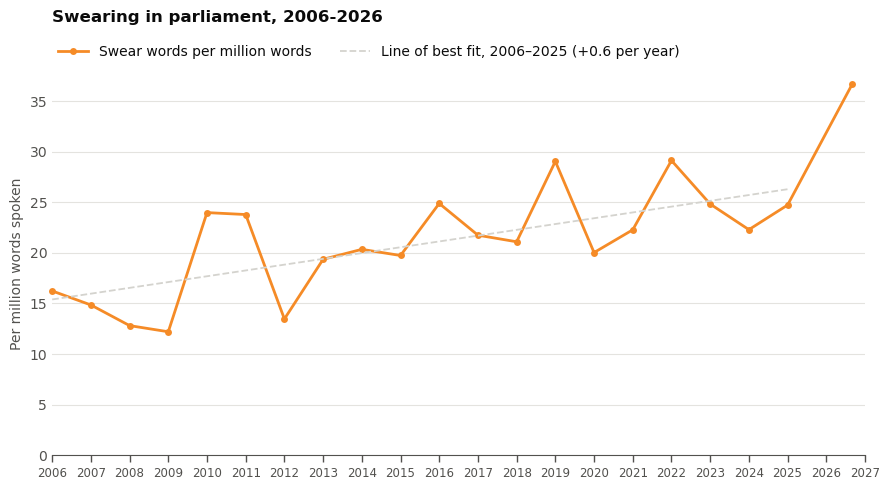
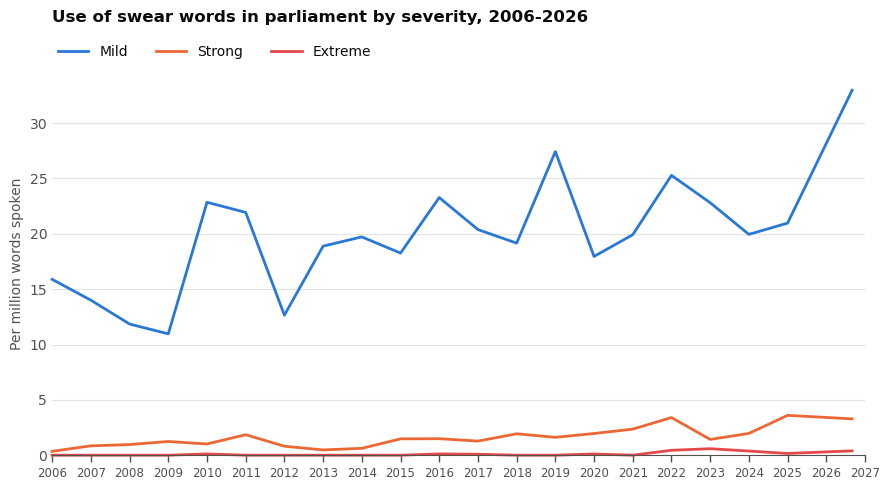
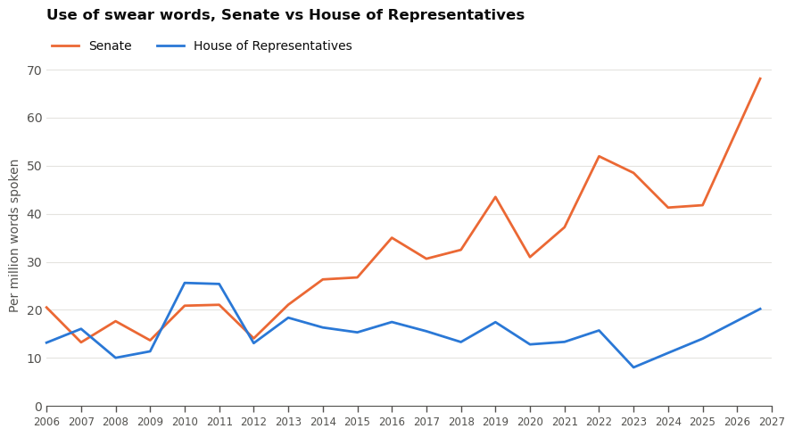
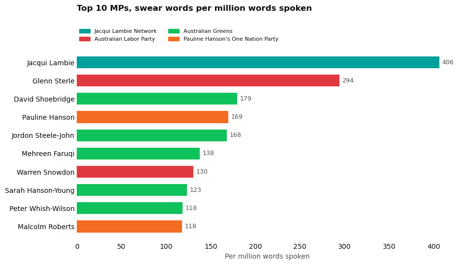
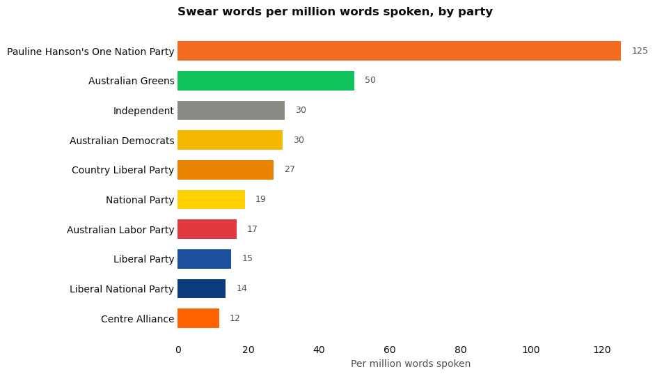
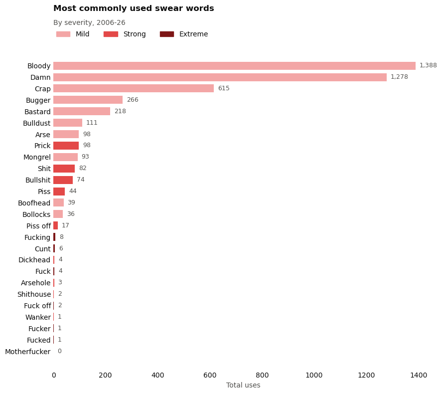
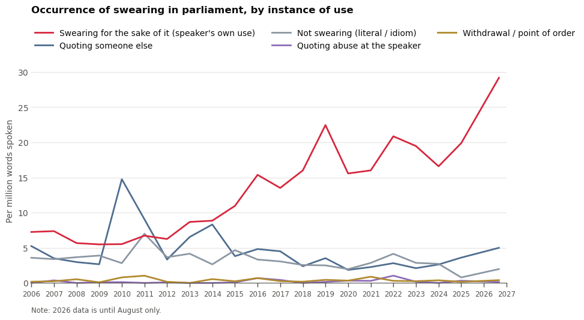
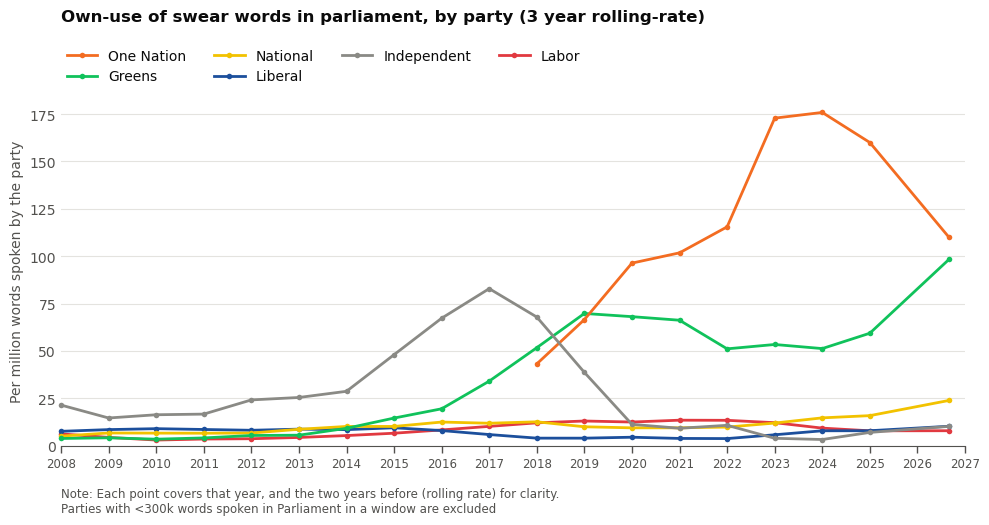

# **Swearing in parliament**

Some MPs are allegedly swearing (and then not withdrawing the comments) to get kicked out of parliament for social media content

Separately, the attack on Helen Haines led to a discussion around vitriol directed at politicians, and whether it has gotten worse, needs to be toned down, etc.

So, how much do politicians swear, and has it increased? 

### Questions:
- Has swearing changed over time?
- Who are the top offenders? Top 10 MPs by total number of words spoken and rate by party
- What words are most/least common?
- How many times are politicans quoting abuse directed towards them, versus those who are actually using swear words for their intended use?
- How does the use of swear words by politicans compare to those commonly used in popular TV (most popular Australian tv shows, movies, podcasts) or music?

### Sources:
Speeches (to text) in the House of Representatives and the Senate, from Hansard via OpenAustralia. Roughly 700k speeches and 214m words

### Notes: 
- Have used 26-word list of swear words pulled by Andy, as well as labels of severity - this includes words and their variants, eg. bastard, bastards
- Have differed from Andy's analysis by taking word use (by count) instead of speeches containing a word
- For standardisation, have created a measure per million words (to avoid discrepancies in sitting days per year distorting results)


```python
# setup
import sqlite3
import pandas as pd
from pathlib import Path
import numpy as np
import matplotlib.pyplot as plt
import re
import math
from matplotlib.patches import Patch

DB  = "/Users/hannah/Desktop/parliament-speeches.sqlite"
OUT = Path("/Users/hannah/Desktop/parliament-csv")   
OUT.mkdir(exist_ok=True)

con = sqlite3.connect(f"file:{DB}?mode=ro", uri=True)

for t in ["parliaments", "people", "swearing_terms", "swearing_hits"]:
    pd.read_sql(f"SELECT * FROM {t}", con).to_csv(OUT / f"{t}.csv", index=False)

# speeches without the body text, one row per speech
cols = [r[1] for r in con.execute("PRAGMA table_info(speeches)") if r[1] != "body_text"]
pd.read_sql(f"SELECT {', '.join(cols)} FROM speeches", con).to_csv(OUT / "speeches_meta.csv", index=False)

for f in sorted(OUT.glob("*.csv")):
    print(f.name, round(f.stat().st_size / 1e6, 1), "MB")
```

    parliaments.csv 0.0 MB
    people.csv 0.1 MB
    scan26.csv 0.6 MB
    speeches_meta.csv 259.2 MB
    swearing_hits.csv 1.4 MB
    swearing_terms.csv 0.0 MB


```python
# convert to csv for reading in pandas 
hits     = pd.read_csv(OUT / "swearing_hits.csv", dtype={"gid": str})
people   = pd.read_csv(OUT / "people.csv")
terms    = pd.read_csv(OUT / "swearing_terms.csv")
speeches = pd.read_csv(OUT / "speeches_meta.csv", dtype={"gid": str})
```


```python
# cleanup
words = speeches.groupby("speech_year")["word_count"].sum().rename("words")

clean = hits[(hits.counted == 1) & (hits.in_quote == 0) & (hits.proper_noun == 0)]
n = clean.groupby(["speech_year", "severity"]).size().unstack(fill_value=0)
```


```python
# view sample rows
hits[["speech_date", "speaker_name", "term", "severity", "in_quote", "snippet"]].sample(10, random_state=1)
```


<div>
<style scoped>
    .dataframe tbody tr th:only-of-type {
        vertical-align: middle;
    }

    .dataframe tbody tr th {
        vertical-align: top;
    }

    .dataframe thead th {
        text-align: right;
    }
</style>
<table border="1" class="dataframe">
  <thead>
    <tr style="text-align: right;">
      <th></th>
      <th>speech_date</th>
      <th>speaker_name</th>
      <th>term</th>
      <th>severity</th>
      <th>in_quote</th>
      <th>snippet</th>
    </tr>
  </thead>
  <tbody>
    <tr>
      <th>749</th>
      <td>2012-02-13</td>
      <td>Craig Kelly</td>
      <td>Bastard</td>
      <td>mild</td>
      <td>1</td>
      <td>…bor member who votes for it. I call on the In...</td>
    </tr>
    <tr>
      <th>3226</th>
      <td>2017-08-14</td>
      <td>Nick Xenophon</td>
      <td>Damn</td>
      <td>mild</td>
      <td>0</td>
      <td>…ssed the Senate last week. When I spoke to he...</td>
    </tr>
    <tr>
      <th>3137</th>
      <td>2016-11-29</td>
      <td>Jacqui Lambie</td>
      <td>Crap</td>
      <td>mild</td>
      <td>0</td>
      <td>…to draft it and no matter how many amendments...</td>
    </tr>
    <tr>
      <th>2453</th>
      <td>2010-10-27</td>
      <td>Anne McEwen</td>
      <td>Crap</td>
      <td>mild</td>
      <td>0</td>
      <td>…and controlled by climate change deniers and ...</td>
    </tr>
    <tr>
      <th>4356</th>
      <td>2024-09-19</td>
      <td>David Shoebridge</td>
      <td>Bullshit</td>
      <td>strong</td>
      <td>0</td>
      <td>…al this and that—'Oh it was all meant to be c...</td>
    </tr>
    <tr>
      <th>836</th>
      <td>2012-11-28</td>
      <td>Andrew Wilkie</td>
      <td>Bastard</td>
      <td>mild</td>
      <td>0</td>
      <td>…ember about her gambling problem. In other wo...</td>
    </tr>
    <tr>
      <th>1342</th>
      <td>2017-05-10</td>
      <td>Nick Champion</td>
      <td>Bulldust</td>
      <td>mild</td>
      <td>0</td>
      <td>Not up his way? That is bulldust and you know it.</td>
    </tr>
    <tr>
      <th>2876</th>
      <td>2015-02-11</td>
      <td>Matthew Canavan</td>
      <td>Bloody</td>
      <td>mild</td>
      <td>0</td>
      <td>…it is a good idea. The example of the Labor P...</td>
    </tr>
    <tr>
      <th>62</th>
      <td>2006-10-16</td>
      <td>Kevin Rudd</td>
      <td>Damn</td>
      <td>mild</td>
      <td>0</td>
      <td>…comes to ritualistic use and abuse of nationa...</td>
    </tr>
    <tr>
      <th>1237</th>
      <td>2016-05-02</td>
      <td>Eric Hutchinson</td>
      <td>Damn</td>
      <td>mild</td>
      <td>0</td>
      <td>…that are providing these very important patho...</td>
    </tr>
  </tbody>
</table>
</div>


```python
# cleaning
terms = pd.read_sql("SELECT * FROM swearing_terms WHERE counted = 1", con)   

# every spelling variant, its term & each term, its severity
var2term = {v.strip().lower(): r.term for _, r in terms.iterrows() for v in r.variants.split(",")}
severity = dict(zip(terms.term, terms.severity))

# phrases that look like swearing but aren't, eg "bloody-minded"
excl = {e.strip().lower() for x in terms.excluded.dropna() for e in x.split(",") if e.strip()}

def alt(words):   
    return "|".join(re.escape(w) for w in sorted(words, key=len, reverse=True))

pat   = re.compile(r"(?<!\w)(?:" + alt(var2term) + r")(?!\w)", re.I)
expat = re.compile(r"(?<!\w)(?:" + alt(excl) + r")(?!\w)", re.I)

rows = []
cur = con.execute("SELECT chamber, gid, speech_date, speech_year, person_id, speaker_name, party, body_text FROM speeches")
for ch, gid, d, y, pid, name, party, text in cur:
    matches = list(pat.finditer(text))
    if not matches:
        continue
    skip = [(m.start(), m.end()) for m in expat.finditer(text)]
    for m in matches:
        if any(s <= m.start() < e for s, e in skip):
            continue                                    
        tok  = m.group(0).lower()
        term = var2term[tok]
        rows.append((ch, gid, d, y, pid, name, party, term, severity[term], tok, m.start()))

scan = pd.DataFrame(rows, columns=["chamber", "gid", "date", "year", "person_id", "name",
                                   "party", "term", "severity", "token", "offset"])
scan["speech"] = scan.chamber + "|" + scan.gid
len(scan)   
```


    4489


### **Has swearing changed over time? Top figures**

Swearing is up approximately 78% over the period of 2006-2026

The rise comes almost entirely from the Senate rather than the House of Representatives

0.5% of all speeches include a swear word

The rate (four-year average) in 2006-9 was 14. In 2022-5 it was 24.9.

The lowest year was 2009 (12.2). The highest year was 2022 (29.1).

While incomplete, 2026 so far has been the highest of any year (36.6). 

The five heaviest users (Jacqui Lambie, Glenn Sterle, Bill Heffernan, Peter Whish-Wilson, Pauline Hanson) account for 18% of all uses, and the top ten for 28%.

Over the time period, mild swear words make up the majority (92%). 7% are strong, 0.5% are extreme. But strong and extreme words combined rose 3.3 times, from 0.85 to 2.77 per million - a faster proportional rise than mild words.

Among people who spoke in each period, the share who swore at least once fell from 59% (173 of 293) to 50% (159 of 321). This means the rise isn't due to an increase in people swearing, but rather those who swear, swearing more. 

The Senate rate rose from about 14–21 per million words (2006–13) to about 41–52 (2022–25), while the House stayed flat. Crossbench and Greens senators drive the late period.


```python
per_million = n.div(words, axis=0) * 1e6
per_million["all"] = per_million.sum(axis=1)
per_million.round(1)
```


<div>
<style scoped>
    .dataframe tbody tr th:only-of-type {
        vertical-align: middle;
    }

    .dataframe tbody tr th {
        vertical-align: top;
    }

    .dataframe thead th {
        text-align: right;
    }
</style>
<table border="1" class="dataframe">
  <thead>
    <tr style="text-align: right;">
      <th>severity</th>
      <th>extreme</th>
      <th>mild</th>
      <th>strong</th>
      <th>all</th>
    </tr>
    <tr>
      <th>speech_year</th>
      <th></th>
      <th></th>
      <th></th>
      <th></th>
    </tr>
  </thead>
  <tbody>
    <tr>
      <th>2006</th>
      <td>0.0</td>
      <td>12.0</td>
      <td>0.3</td>
      <td>12.3</td>
    </tr>
    <tr>
      <th>2007</th>
      <td>0.0</td>
      <td>9.1</td>
      <td>0.6</td>
      <td>9.7</td>
    </tr>
    <tr>
      <th>2008</th>
      <td>0.0</td>
      <td>8.4</td>
      <td>0.7</td>
      <td>9.1</td>
    </tr>
    <tr>
      <th>2009</th>
      <td>0.0</td>
      <td>8.7</td>
      <td>0.9</td>
      <td>9.5</td>
    </tr>
    <tr>
      <th>2010</th>
      <td>0.0</td>
      <td>13.3</td>
      <td>0.7</td>
      <td>14.0</td>
    </tr>
    <tr>
      <th>2011</th>
      <td>0.0</td>
      <td>14.1</td>
      <td>1.2</td>
      <td>15.4</td>
    </tr>
    <tr>
      <th>2012</th>
      <td>0.0</td>
      <td>9.5</td>
      <td>0.7</td>
      <td>10.2</td>
    </tr>
    <tr>
      <th>2013</th>
      <td>0.0</td>
      <td>13.3</td>
      <td>0.4</td>
      <td>13.7</td>
    </tr>
    <tr>
      <th>2014</th>
      <td>0.0</td>
      <td>13.3</td>
      <td>0.4</td>
      <td>13.7</td>
    </tr>
    <tr>
      <th>2015</th>
      <td>0.0</td>
      <td>14.7</td>
      <td>1.1</td>
      <td>15.8</td>
    </tr>
    <tr>
      <th>2016</th>
      <td>0.1</td>
      <td>17.4</td>
      <td>1.3</td>
      <td>18.8</td>
    </tr>
    <tr>
      <th>2017</th>
      <td>0.0</td>
      <td>16.5</td>
      <td>0.7</td>
      <td>17.2</td>
    </tr>
    <tr>
      <th>2018</th>
      <td>0.0</td>
      <td>16.4</td>
      <td>1.6</td>
      <td>18.0</td>
    </tr>
    <tr>
      <th>2019</th>
      <td>0.0</td>
      <td>22.4</td>
      <td>0.9</td>
      <td>23.3</td>
    </tr>
    <tr>
      <th>2020</th>
      <td>0.0</td>
      <td>15.1</td>
      <td>1.6</td>
      <td>16.8</td>
    </tr>
    <tr>
      <th>2021</th>
      <td>0.0</td>
      <td>16.7</td>
      <td>1.7</td>
      <td>18.4</td>
    </tr>
    <tr>
      <th>2022</th>
      <td>0.1</td>
      <td>22.5</td>
      <td>2.2</td>
      <td>24.8</td>
    </tr>
    <tr>
      <th>2023</th>
      <td>0.3</td>
      <td>20.9</td>
      <td>1.3</td>
      <td>22.6</td>
    </tr>
    <tr>
      <th>2024</th>
      <td>0.1</td>
      <td>17.7</td>
      <td>1.4</td>
      <td>19.2</td>
    </tr>
    <tr>
      <th>2025</th>
      <td>0.0</td>
      <td>18.8</td>
      <td>2.8</td>
      <td>21.6</td>
    </tr>
    <tr>
      <th>2026</th>
      <td>0.3</td>
      <td>28.5</td>
      <td>2.5</td>
      <td>31.3</td>
    </tr>
  </tbody>
</table>
</div>


```python
# total words spoken each year 
words = speeches.groupby("speech_year")["word_count"].sum()

def per_million(df):
    """Hits per million words spoken, for each year."""
    return df.groupby("speech_year").size().reindex(words.index, fill_value=0) / words * 1e6

counted = hits[hits.counted == 1]
clean   = counted[(counted.in_quote == 0) & (counted.proper_noun == 0)]

all_counted = per_million(counted)                           
headline    = per_million(clean)                             
strong_up   = per_million(clean[clean.severity != "mild"])   

pd.DataFrame({"all": all_counted, "headline": headline, "strong_up": strong_up}).round(1).T
```


<div>
<style scoped>
    .dataframe tbody tr th:only-of-type {
        vertical-align: middle;
    }

    .dataframe tbody tr th {
        vertical-align: top;
    }

    .dataframe thead th {
        text-align: right;
    }
</style>
<table border="1" class="dataframe">
  <thead>
    <tr style="text-align: right;">
      <th>speech_year</th>
      <th>2006</th>
      <th>2007</th>
      <th>2008</th>
      <th>2009</th>
      <th>2010</th>
      <th>2011</th>
      <th>2012</th>
      <th>2013</th>
      <th>2014</th>
      <th>2015</th>
      <th>...</th>
      <th>2017</th>
      <th>2018</th>
      <th>2019</th>
      <th>2020</th>
      <th>2021</th>
      <th>2022</th>
      <th>2023</th>
      <th>2024</th>
      <th>2025</th>
      <th>2026</th>
    </tr>
  </thead>
  <tbody>
    <tr>
      <th>all</th>
      <td>16.2</td>
      <td>14.8</td>
      <td>12.8</td>
      <td>12.2</td>
      <td>24.0</td>
      <td>23.8</td>
      <td>13.5</td>
      <td>19.4</td>
      <td>20.3</td>
      <td>19.7</td>
      <td>...</td>
      <td>21.7</td>
      <td>21.1</td>
      <td>29.0</td>
      <td>20.0</td>
      <td>22.3</td>
      <td>29.1</td>
      <td>24.8</td>
      <td>22.3</td>
      <td>24.7</td>
      <td>36.6</td>
    </tr>
    <tr>
      <th>headline</th>
      <td>12.3</td>
      <td>9.7</td>
      <td>9.1</td>
      <td>9.5</td>
      <td>14.0</td>
      <td>15.4</td>
      <td>10.2</td>
      <td>13.7</td>
      <td>13.7</td>
      <td>15.8</td>
      <td>...</td>
      <td>17.2</td>
      <td>18.0</td>
      <td>23.3</td>
      <td>16.8</td>
      <td>18.4</td>
      <td>24.8</td>
      <td>22.6</td>
      <td>19.2</td>
      <td>21.6</td>
      <td>31.3</td>
    </tr>
    <tr>
      <th>strong_up</th>
      <td>0.3</td>
      <td>0.6</td>
      <td>0.7</td>
      <td>0.9</td>
      <td>0.7</td>
      <td>1.2</td>
      <td>0.7</td>
      <td>0.4</td>
      <td>0.4</td>
      <td>1.1</td>
      <td>...</td>
      <td>0.7</td>
      <td>1.6</td>
      <td>0.9</td>
      <td>1.6</td>
      <td>1.7</td>
      <td>2.4</td>
      <td>1.7</td>
      <td>1.5</td>
      <td>2.8</td>
      <td>2.8</td>
    </tr>
  </tbody>
</table>
<p>3 rows × 21 columns</p>
</div>


```python
# swearing by time
total = scan.groupby("year").size().reindex(words.index, fill_value=0) / words * 1e6

INK, MUTED, GRID = "#0b0b0b", "#52514e", "#e4e3df"
LINE = "#F58B27"                 
FIT  = "#d4d3ce"                  
PARTIAL_END = 2026 + 8 / 12       

full = total.index < 2026
slope, intercept = np.polyfit(total.index[full], total[full], 1)

x = total.index.to_numpy(dtype=float)
x[-1] = PARTIAL_END

fig, ax = plt.subplots(figsize=(9, 5))
for s in ["top", "right", "left"]:
    ax.spines[s].set_visible(False)
ax.spines["bottom"].set_color(MUTED)
ax.grid(axis="y", color=GRID, lw=0.8)
ax.set_axisbelow(True)
ax.tick_params(axis="y", length=0, colors=MUTED)
ax.set_xticks(range(2006, 2028))                                          
ax.tick_params(axis="x", length=5, width=1, color=MUTED, labelcolor=MUTED, labelsize=8.5)

ax.plot(x, total.values, color=LINE, lw=2, marker="o", ms=5, mew=0,        
        clip_on=False, label="Swear words per million words")

fx = np.array([2006, 2025])
ax.plot(fx, slope * fx + intercept, color=FIT, lw=1.3, ls="--", clip_on=False,
        label=f"Line of best fit, 2006\u20132025 (+{slope:.1f} per year)")

ax.set_xlim(2006, 2027)                                                    
ax.set_ylim(bottom=0)
ax.margins(x=0)
ax.set_ylabel("Per million words spoken", color=MUTED)
ax.legend(frameon=False, loc="lower left", bbox_to_anchor=(0, 1.02), ncol=2,    
          labelcolor=INK, borderaxespad=0, handlelength=2.2)
ax.set_title("Swearing in parliament, 2006-2026", loc="left", color=INK, fontweight="bold", pad=36)
plt.tight_layout(); plt.show()

# data wrapper export
DW_OUT = OUT / "datawrapper"
DW_OUT.mkdir(parents=True, exist_ok=True)
dw = pd.DataFrame({
    "Year": total.index,
    "Swear words per million words": total.round(2).values,
    "Line of best fit (2006-2025)": [round(slope * y + intercept, 2) if y < 2026 else None for y in total.index],
})
dw.to_csv(DW_OUT / "swearing_in_parliament_per_million_words_2006-2026.csv", index=False)
dw
```


    

    


<div>
<style scoped>
    .dataframe tbody tr th:only-of-type {
        vertical-align: middle;
    }

    .dataframe tbody tr th {
        vertical-align: top;
    }

    .dataframe thead th {
        text-align: right;
    }
</style>
<table border="1" class="dataframe">
  <thead>
    <tr style="text-align: right;">
      <th></th>
      <th>Year</th>
      <th>Swear words per million words</th>
      <th>Line of best fit (2006-2025)</th>
    </tr>
  </thead>
  <tbody>
    <tr>
      <th>0</th>
      <td>2006</td>
      <td>16.23</td>
      <td>15.39</td>
    </tr>
    <tr>
      <th>1</th>
      <td>2007</td>
      <td>14.85</td>
      <td>15.96</td>
    </tr>
    <tr>
      <th>2</th>
      <td>2008</td>
      <td>12.81</td>
      <td>16.54</td>
    </tr>
    <tr>
      <th>3</th>
      <td>2009</td>
      <td>12.20</td>
      <td>17.11</td>
    </tr>
    <tr>
      <th>4</th>
      <td>2010</td>
      <td>23.98</td>
      <td>17.68</td>
    </tr>
    <tr>
      <th>5</th>
      <td>2011</td>
      <td>23.78</td>
      <td>18.26</td>
    </tr>
    <tr>
      <th>6</th>
      <td>2012</td>
      <td>13.46</td>
      <td>18.83</td>
    </tr>
    <tr>
      <th>7</th>
      <td>2013</td>
      <td>19.36</td>
      <td>19.41</td>
    </tr>
    <tr>
      <th>8</th>
      <td>2014</td>
      <td>20.34</td>
      <td>19.98</td>
    </tr>
    <tr>
      <th>9</th>
      <td>2015</td>
      <td>19.74</td>
      <td>20.55</td>
    </tr>
    <tr>
      <th>10</th>
      <td>2016</td>
      <td>24.88</td>
      <td>21.13</td>
    </tr>
    <tr>
      <th>11</th>
      <td>2017</td>
      <td>21.74</td>
      <td>21.70</td>
    </tr>
    <tr>
      <th>12</th>
      <td>2018</td>
      <td>21.09</td>
      <td>22.27</td>
    </tr>
    <tr>
      <th>13</th>
      <td>2019</td>
      <td>29.04</td>
      <td>22.85</td>
    </tr>
    <tr>
      <th>14</th>
      <td>2020</td>
      <td>20.03</td>
      <td>23.42</td>
    </tr>
    <tr>
      <th>15</th>
      <td>2021</td>
      <td>22.28</td>
      <td>23.99</td>
    </tr>
    <tr>
      <th>16</th>
      <td>2022</td>
      <td>29.13</td>
      <td>24.57</td>
    </tr>
    <tr>
      <th>17</th>
      <td>2023</td>
      <td>24.82</td>
      <td>25.14</td>
    </tr>
    <tr>
      <th>18</th>
      <td>2024</td>
      <td>22.29</td>
      <td>25.71</td>
    </tr>
    <tr>
      <th>19</th>
      <td>2025</td>
      <td>24.72</td>
      <td>26.29</td>
    </tr>
    <tr>
      <th>20</th>
      <td>2026</td>
      <td>36.65</td>
      <td>NaN</td>
    </tr>
  </tbody>
</table>
</div>


```python
# swearing severity
by_sev = (scan.groupby(["year", "severity"]).size().unstack(fill_value=0)
              .reindex(words.index, fill_value=0)
              .reindex(columns=["mild", "strong", "extreme"], fill_value=0)
              .div(words, axis=0) * 1e6)

INK, MUTED, GRID = "#0b0b0b", "#52514e", "#e4e3df"
COLOURS = {"mild": "#2a78d6", "strong": "#eb6834", "extreme": "#e34948"}
PARTIAL_END = 2026 + 8 / 12       

x = by_sev.index.to_numpy(dtype=float)
x[-1] = PARTIAL_END

fig, ax = plt.subplots(figsize=(9, 5))
for s in ["top", "right", "left"]:
    ax.spines[s].set_visible(False)
ax.spines["bottom"].set_color(MUTED)
ax.grid(axis="y", color=GRID, lw=0.8)
ax.set_axisbelow(True)
ax.tick_params(axis="y", length=0, colors=MUTED)
ax.set_xticks(range(2006, 2028))
ax.tick_params(axis="x", length=5, width=1, color=MUTED, labelcolor=MUTED, labelsize=8.5)

for severity, colour in COLOURS.items():
    ax.plot(x, by_sev[severity], color=colour, lw=2, clip_on=False, label=severity.capitalize())

ax.set_xlim(2006, 2027)
ax.set_ylim(bottom=0)
ax.set_ylabel("Per million words spoken", color=MUTED)
ax.legend(frameon=False, loc="lower left", bbox_to_anchor=(0, 1.02), ncol=3,
          labelcolor=INK, borderaxespad=0, handlelength=2.2)
ax.set_title("Use of swear words in parliament by severity, 2006-2026", loc="left", color=INK, fontweight="bold", pad=36)
plt.tight_layout(); plt.show()

# data wrapper export
DW_OUT = OUT / "datawrapper"
DW_OUT.mkdir(parents=True, exist_ok=True)
dw = by_sev.round(2).rename(columns=str.capitalize).rename_axis("Year").reset_index()
dw.to_csv(DW_OUT / "swearing_in_parliament_by_severity_per_million_words_2006-2026.csv", index=False)
dw
```


    

    


<div>
<style scoped>
    .dataframe tbody tr th:only-of-type {
        vertical-align: middle;
    }

    .dataframe tbody tr th {
        vertical-align: top;
    }

    .dataframe thead th {
        text-align: right;
    }
</style>
<table border="1" class="dataframe">
  <thead>
    <tr style="text-align: right;">
      <th>severity</th>
      <th>Year</th>
      <th>Mild</th>
      <th>Strong</th>
      <th>Extreme</th>
    </tr>
  </thead>
  <tbody>
    <tr>
      <th>0</th>
      <td>2006</td>
      <td>15.88</td>
      <td>0.35</td>
      <td>0.00</td>
    </tr>
    <tr>
      <th>1</th>
      <td>2007</td>
      <td>14.00</td>
      <td>0.84</td>
      <td>0.00</td>
    </tr>
    <tr>
      <th>2</th>
      <td>2008</td>
      <td>11.85</td>
      <td>0.96</td>
      <td>0.00</td>
    </tr>
    <tr>
      <th>3</th>
      <td>2009</td>
      <td>10.96</td>
      <td>1.24</td>
      <td>0.00</td>
    </tr>
    <tr>
      <th>4</th>
      <td>2010</td>
      <td>22.85</td>
      <td>1.01</td>
      <td>0.11</td>
    </tr>
    <tr>
      <th>5</th>
      <td>2011</td>
      <td>21.93</td>
      <td>1.85</td>
      <td>0.00</td>
    </tr>
    <tr>
      <th>6</th>
      <td>2012</td>
      <td>12.65</td>
      <td>0.81</td>
      <td>0.00</td>
    </tr>
    <tr>
      <th>7</th>
      <td>2013</td>
      <td>18.88</td>
      <td>0.48</td>
      <td>0.00</td>
    </tr>
    <tr>
      <th>8</th>
      <td>2014</td>
      <td>19.72</td>
      <td>0.62</td>
      <td>0.00</td>
    </tr>
    <tr>
      <th>9</th>
      <td>2015</td>
      <td>18.26</td>
      <td>1.48</td>
      <td>0.00</td>
    </tr>
    <tr>
      <th>10</th>
      <td>2016</td>
      <td>23.28</td>
      <td>1.49</td>
      <td>0.11</td>
    </tr>
    <tr>
      <th>11</th>
      <td>2017</td>
      <td>20.38</td>
      <td>1.27</td>
      <td>0.08</td>
    </tr>
    <tr>
      <th>12</th>
      <td>2018</td>
      <td>19.16</td>
      <td>1.93</td>
      <td>0.00</td>
    </tr>
    <tr>
      <th>13</th>
      <td>2019</td>
      <td>27.43</td>
      <td>1.61</td>
      <td>0.00</td>
    </tr>
    <tr>
      <th>14</th>
      <td>2020</td>
      <td>17.96</td>
      <td>1.96</td>
      <td>0.11</td>
    </tr>
    <tr>
      <th>15</th>
      <td>2021</td>
      <td>19.92</td>
      <td>2.36</td>
      <td>0.00</td>
    </tr>
    <tr>
      <th>16</th>
      <td>2022</td>
      <td>25.28</td>
      <td>3.40</td>
      <td>0.44</td>
    </tr>
    <tr>
      <th>17</th>
      <td>2023</td>
      <td>22.81</td>
      <td>1.43</td>
      <td>0.59</td>
    </tr>
    <tr>
      <th>18</th>
      <td>2024</td>
      <td>19.95</td>
      <td>1.97</td>
      <td>0.37</td>
    </tr>
    <tr>
      <th>19</th>
      <td>2025</td>
      <td>20.97</td>
      <td>3.60</td>
      <td>0.16</td>
    </tr>
    <tr>
      <th>20</th>
      <td>2026</td>
      <td>32.97</td>
      <td>3.28</td>
      <td>0.39</td>
    </tr>
  </tbody>
</table>
</div>


```python
EARLY, LATE = (2006, 2009), (2022, 2025)      

def rate(hits, spk, a, b):
    """Swear words per million words spoken, over years a..b."""
    h = hits[hits.year.between(a, b)].shape[0]
    w = spk[spk.speech_year.between(a, b)].word_count.sum()
    return h / w * 1e6

e, l = rate(scan, speeches, *EARLY), rate(scan, speeches, *LATE)
print(f"Overall: {e:.1f} -> {l:.1f} per million words (+{(l/e-1)*100:.0f}%)")

for ch in ["representatives", "senate"]:
    s, h = speeches[speeches.chamber == ch], scan[scan.chamber == ch]
    a, b = rate(h, s, *EARLY), rate(h, s, *LATE)
    print(f"{ch}: {a:.1f} -> {b:.1f} ({(b/a-1)*100:+.0f}%)")

top5 = scan.groupby("person_id").size().nlargest(5).index
a = rate(scan[~scan.person_id.isin(top5)], speeches[~speeches.person_id.isin(top5)], *EARLY)
b = rate(scan[~scan.person_id.isin(top5)], speeches[~speeches.person_id.isin(top5)], *LATE)
print(f"Excluding the top 5 swearers: {a:.1f} -> {b:.1f} ({(b/a-1)*100:+.0f}%)")

sev = scan.groupby(["year", "severity"]).size().unstack(fill_value=0)
for name, (a, b) in [("early", EARLY), ("late", LATE)]:
    w = speeches[speeches.speech_year.between(a, b)].word_count.sum()
    print(name, (sev.loc[a:b].sum() / w * 1e6).round(2).to_dict())
```

    Overall: 14.0 -> 24.9 per million words (+78%)
    representatives: 12.3 -> 11.5 (-6%)
    senate: 16.5 -> 45.9 (+177%)
    Excluding the top 5 swearers: 12.5 -> 18.7 (+50%)
    early {'extreme': 0.0, 'mild': 13.12, 'strong': 0.85}
    late {'extreme': 0.42, 'mild': 22.09, 'strong': 2.35}


```python
# senate analysis
words = speeches.groupby(["speech_year", "chamber"]).word_count.sum().unstack()
uses = scan.groupby(["year", "chamber"]).size().unstack(fill_value=0).reindex(words.index, fill_value=0)
by_chamber = uses / words * 1e6

INK, MUTED, GRID = "#0b0b0b", "#52514e", "#e4e3df"
COLOURS = {"senate": ("Senate", "#eb6834"), "representatives": ("House of Representatives", "#2a78d6")}
PARTIAL_END = 2026 + 8 / 12

x = by_chamber.index.to_numpy(dtype=float)
x[-1] = PARTIAL_END

fig, ax = plt.subplots(figsize=(9, 5))
for s in ["top", "right", "left"]:
    ax.spines[s].set_visible(False)
ax.spines["bottom"].set_color(MUTED)
ax.grid(axis="y", color=GRID, lw=0.8)
ax.set_axisbelow(True)
ax.tick_params(axis="y", length=0, colors=MUTED)
ax.set_xticks(range(2006, 2028))
ax.tick_params(axis="x", length=5, width=1, color=MUTED, labelcolor=MUTED, labelsize=8.5)

for chamber, (label, colour) in COLOURS.items():
    ax.plot(x, by_chamber[chamber], color=colour, lw=2, clip_on=False, label=label)

ax.set_xlim(2006, 2027)
ax.set_ylim(bottom=0)
ax.set_ylabel("Per million words spoken", color=MUTED)
ax.legend(frameon=False, loc="lower left", bbox_to_anchor=(0, 1.02), ncol=2,
          labelcolor=INK, borderaxespad=0, handlelength=2.2)
ax.set_title("Use of swear words, Senate vs House of Representatives", loc="left", color=INK, fontweight="bold", pad=36)
plt.tight_layout(); plt.show()

DW_OUT = OUT / "datawrapper"
DW_OUT.mkdir(parents=True, exist_ok=True)
dw = by_chamber[["senate", "representatives"]].round(2)
dw.columns = ["Senate", "House of Representatives"]
dw = dw.rename_axis("Year").reset_index()
dw.to_csv(DW_OUT / "swearing_in_parliament_by_chamber_per_million_words_2006-2026.csv", index=False)
dw
```


    

    


<div>
<style scoped>
    .dataframe tbody tr th:only-of-type {
        vertical-align: middle;
    }

    .dataframe tbody tr th {
        vertical-align: top;
    }

    .dataframe thead th {
        text-align: right;
    }
</style>
<table border="1" class="dataframe">
  <thead>
    <tr style="text-align: right;">
      <th></th>
      <th>Year</th>
      <th>Senate</th>
      <th>House of Representatives</th>
    </tr>
  </thead>
  <tbody>
    <tr>
      <th>0</th>
      <td>2006</td>
      <td>20.51</td>
      <td>13.18</td>
    </tr>
    <tr>
      <th>1</th>
      <td>2007</td>
      <td>13.24</td>
      <td>16.05</td>
    </tr>
    <tr>
      <th>2</th>
      <td>2008</td>
      <td>17.64</td>
      <td>10.02</td>
    </tr>
    <tr>
      <th>3</th>
      <td>2009</td>
      <td>13.66</td>
      <td>11.37</td>
    </tr>
    <tr>
      <th>4</th>
      <td>2010</td>
      <td>20.87</td>
      <td>25.61</td>
    </tr>
    <tr>
      <th>5</th>
      <td>2011</td>
      <td>21.06</td>
      <td>25.39</td>
    </tr>
    <tr>
      <th>6</th>
      <td>2012</td>
      <td>14.07</td>
      <td>13.08</td>
    </tr>
    <tr>
      <th>7</th>
      <td>2013</td>
      <td>21.07</td>
      <td>18.37</td>
    </tr>
    <tr>
      <th>8</th>
      <td>2014</td>
      <td>26.34</td>
      <td>16.33</td>
    </tr>
    <tr>
      <th>9</th>
      <td>2015</td>
      <td>26.75</td>
      <td>15.32</td>
    </tr>
    <tr>
      <th>10</th>
      <td>2016</td>
      <td>35.01</td>
      <td>17.47</td>
    </tr>
    <tr>
      <th>11</th>
      <td>2017</td>
      <td>30.64</td>
      <td>15.55</td>
    </tr>
    <tr>
      <th>12</th>
      <td>2018</td>
      <td>32.49</td>
      <td>13.31</td>
    </tr>
    <tr>
      <th>13</th>
      <td>2019</td>
      <td>43.50</td>
      <td>17.44</td>
    </tr>
    <tr>
      <th>14</th>
      <td>2020</td>
      <td>30.99</td>
      <td>12.81</td>
    </tr>
    <tr>
      <th>15</th>
      <td>2021</td>
      <td>37.19</td>
      <td>13.34</td>
    </tr>
    <tr>
      <th>16</th>
      <td>2022</td>
      <td>51.97</td>
      <td>15.72</td>
    </tr>
    <tr>
      <th>17</th>
      <td>2023</td>
      <td>48.50</td>
      <td>8.03</td>
    </tr>
    <tr>
      <th>18</th>
      <td>2024</td>
      <td>41.29</td>
      <td>11.04</td>
    </tr>
    <tr>
      <th>19</th>
      <td>2025</td>
      <td>41.79</td>
      <td>14.01</td>
    </tr>
    <tr>
      <th>20</th>
      <td>2026</td>
      <td>68.12</td>
      <td>20.20</td>
    </tr>
  </tbody>
</table>
</div>


```python
sen = scan[scan.chamber == "senate"]
for a, b in [(2006, 2009), (2022, 2025)]:
    h = sen[sen.year.between(a, b)]
    print(f"--- Senate {a}-{b}: {len(h)} uses ---")
    print(h.groupby("name").size().nlargest(6).to_string())
    print(h.groupby("party").size().nlargest(5).to_string())
```

    --- Senate 2006-2009: 275 uses ---
    name
    Bill Heffernan           43
    Andrew Bartlett          31
    Glenn Sterle             19
    Bob Brown                 9
    Natasha Stott Despoja     8
    Nigel Scullion            8
    party
    Liberal Party             105
    Australian Labor Party     77
    Australian Democrats       46
    Australian Greens          17
    National Party             14
    --- Senate 2022-2025: 637 uses ---
    name
    Jacqui Lambie         95
    Malcolm Roberts       70
    Pauline Hanson        57
    David Shoebridge      55
    Peter Whish-Wilson    37
    Glenn Sterle          30
    party
    Australian Greens                    193
    Pauline Hanson's One Nation Party    129
    Jacqui Lambie Network                106
    Australian Labor Party                80
    Liberal Party                         70


### **Top swearing MPs and rate of swearing by party? Top figures**

Note: An MP must've spoken at least 250k words to exclude those who have spoken very little from skewing results

A small group of senators swear more than anyone else, whereas the rest of MPs sit close to the average.

Among the 312 MPs with 250,000 or more words, the typical individual (median) is 11 per million.

Only 28 of the 312 swear at more than twice the overall rate.

Jacqui Lambie's swear rate was 406 per million words, 19x the overall average. She is followed by Glenn Sterle, who has a rate of 294 or 14x the average.

Lambie alone is 6% of all uses. 

These top offenders all use mild language more than strong or extreme words. 

Since 2016, in the Senate, the Greens swear at about 4.3 times Labor’s rate and One Nation at about 6.3 times.” Both figures are against Labor’s 20.2

The ten MPs with the highest swearing rates account for more than a quarter of all swearing but only 3% of the total number of words spoken. 

The way the data has been collected means that each MP is assigned their party at the time of each speech, meaning that Lambie's earlier years sit under different labels.

The 250k word cutoff excludes some prime swearers, including Bill Heffernan (877 per million) and Derryn Hinch (398), both senators


```python
# IGNORE BUILD CELL
terms = pd.read_sql("SELECT * FROM swearing_terms WHERE counted = 1", con)   

var2term = {v.strip().lower(): r.term for _, r in terms.iterrows() for v in r.variants.split(",")}
severity = dict(zip(terms.term, terms.severity))

excl = {e.strip().lower() for x in terms.excluded.dropna() for e in x.split(",") if e.strip()}

def alt(words):  
    return "|".join(re.escape(w) for w in sorted(words, key=len, reverse=True))

pat   = re.compile(r"(?<!\w)(?:" + alt(var2term) + r")(?!\w)", re.I)
expat = re.compile(r"(?<!\w)(?:" + alt(excl) + r")(?!\w)", re.I)

rows = []
cur = con.execute("SELECT chamber, gid, speech_date, speech_year, person_id, speaker_name, party, body_text FROM speeches")
for ch, gid, d, y, pid, name, party, text in cur:
    matches = list(pat.finditer(text))
    if not matches:
        continue
    skip = [(m.start(), m.end()) for m in expat.finditer(text)]
    for m in matches:
        if any(s <= m.start() < e for s, e in skip):
            continue                                    
        tok  = m.group(0).lower()
        term = var2term[tok]
        rows.append((ch, gid, d, y, pid, name, party, term, severity[term], tok, m.start()))

scan = pd.DataFrame(rows, columns=["chamber", "gid", "date", "year", "person_id", "name",
                                   "party", "term", "severity", "token", "offset"])
scan["speech"] = scan.chamber + "|" + scan.gid
print(len(scan))                                        

OUT.mkdir(exist_ok=True)
scan.to_csv(OUT / "scan26.csv", index=False)
print("saved:", OUT / "scan26.csv")
```

    4489
    saved: /Users/hannah/Desktop/parliament-csv/scan26.csv


```python
OUT = Path("/Users/hannah/Desktop/parliament-csv")      

def clean_ids(s):
    """Make person_id a clean text ID: '10001', never 10001.0 or 10001."""
    return s.astype("string").str.strip().str.replace(r"\.0$", "", regex=True)

speeches = pd.read_csv(OUT / "speeches_meta.csv", dtype={"gid": str, "person_id": str})
people   = pd.read_csv(OUT / "people.csv",        dtype={"person_id": str})
scan     = pd.read_csv(OUT / "scan26.csv",        dtype={"gid": str, "person_id": str})

for d in (speeches, people, scan):
    d["person_id"] = clean_ids(d["person_id"])

print("scan:", scan.shape, "| speeches:", speeches.shape)
assert len(scan) == 4489 and len(speeches) == 701890, "unexpected row counts"
matched = scan.person_id.dropna().isin(set(people.person_id)).sum()
print("uses whose person_id is found in people:", matched, "(expect 4486)")
assert matched == 4486, "IDs still don't match: check the three person_id columns"
```

    scan: (4489, 12) | speeches: (701890, 17)
    uses whose person_id is found in people: 4486 (expect 4486)


```python
MIN_WORDS = 250_000

words = speeches.groupby("person_id").word_count.sum().rename("words")
uses  = scan.groupby("person_id").size().rename("uses")

mps = (people.set_index("person_id")[["speaker_name", "usual_party", "chamber"]]
             .join(words).join(uses).fillna({"uses": 0}))
mps["per_million"] = mps.uses / mps.words * 1e6

print("total uses attached to people:", mps.uses.sum(), "(expect 4486)")
top10 = mps[mps.words >= MIN_WORDS].nlargest(10, "per_million")
top10.round(1)
```

    total uses attached to people: 4486.0 (expect 4486)


<div>
<style scoped>
    .dataframe tbody tr th:only-of-type {
        vertical-align: middle;
    }

    .dataframe tbody tr th {
        vertical-align: top;
    }

    .dataframe thead th {
        text-align: right;
    }
</style>
<table border="1" class="dataframe">
  <thead>
    <tr style="text-align: right;">
      <th></th>
      <th>speaker_name</th>
      <th>usual_party</th>
      <th>chamber</th>
      <th>words</th>
      <th>uses</th>
      <th>per_million</th>
    </tr>
    <tr>
      <th>person_id</th>
      <th></th>
      <th></th>
      <th></th>
      <th></th>
      <th></th>
      <th></th>
    </tr>
  </thead>
  <tbody>
    <tr>
      <th>10830</th>
      <td>Jacqui Lambie</td>
      <td>Jacqui Lambie Network</td>
      <td>senate</td>
      <td>627664</td>
      <td>255.0</td>
      <td>406.3</td>
    </tr>
    <tr>
      <th>10610</th>
      <td>Glenn Sterle</td>
      <td>Australian Labor Party</td>
      <td>senate</td>
      <td>645623</td>
      <td>190.0</td>
      <td>294.3</td>
    </tr>
    <tr>
      <th>11010</th>
      <td>David Shoebridge</td>
      <td>Australian Greens</td>
      <td>senate</td>
      <td>462479</td>
      <td>83.0</td>
      <td>179.5</td>
    </tr>
    <tr>
      <th>10280</th>
      <td>Pauline Hanson</td>
      <td>Pauline Hanson's One Nation Party</td>
      <td>senate</td>
      <td>649137</td>
      <td>110.0</td>
      <td>169.5</td>
    </tr>
    <tr>
      <th>10901</th>
      <td>Jordon Steele-John</td>
      <td>Australian Greens</td>
      <td>senate</td>
      <td>410811</td>
      <td>69.0</td>
      <td>168.0</td>
    </tr>
    <tr>
      <th>10912</th>
      <td>Mehreen Faruqi</td>
      <td>Australian Greens</td>
      <td>senate</td>
      <td>464361</td>
      <td>64.0</td>
      <td>137.8</td>
    </tr>
    <tr>
      <th>10599</th>
      <td>Warren Snowdon</td>
      <td>Australian Labor Party</td>
      <td>representatives</td>
      <td>712754</td>
      <td>93.0</td>
      <td>130.5</td>
    </tr>
    <tr>
      <th>10711</th>
      <td>Sarah Hanson-Young</td>
      <td>Australian Greens</td>
      <td>senate</td>
      <td>843238</td>
      <td>104.0</td>
      <td>123.3</td>
    </tr>
    <tr>
      <th>10780</th>
      <td>Peter Whish-Wilson</td>
      <td>Australian Greens</td>
      <td>senate</td>
      <td>996370</td>
      <td>118.0</td>
      <td>118.4</td>
    </tr>
    <tr>
      <th>10856</th>
      <td>Malcolm Roberts</td>
      <td>Pauline Hanson's One Nation Party</td>
      <td>senate</td>
      <td>883842</td>
      <td>104.0</td>
      <td>117.7</td>
    </tr>
  </tbody>
</table>
</div>


```python
# top 10 MPs
MIN_WORDS = 250_000

words = speeches.groupby("person_id").word_count.sum().rename("words")
uses  = scan.groupby("person_id").size().rename("uses")

mps = (people.set_index("person_id")[["speaker_name", "usual_party", "chamber"]]
             .join(words).join(uses).fillna({"uses": 0}))
mps["per_million"] = mps.uses / mps.words * 1e6

top10 = mps[mps.words >= MIN_WORDS].nlargest(10, "per_million")
top10.round(1)
```


<div>
<style scoped>
    .dataframe tbody tr th:only-of-type {
        vertical-align: middle;
    }

    .dataframe tbody tr th {
        vertical-align: top;
    }

    .dataframe thead th {
        text-align: right;
    }
</style>
<table border="1" class="dataframe">
  <thead>
    <tr style="text-align: right;">
      <th></th>
      <th>speaker_name</th>
      <th>usual_party</th>
      <th>chamber</th>
      <th>words</th>
      <th>uses</th>
      <th>per_million</th>
    </tr>
    <tr>
      <th>person_id</th>
      <th></th>
      <th></th>
      <th></th>
      <th></th>
      <th></th>
      <th></th>
    </tr>
  </thead>
  <tbody>
    <tr>
      <th>10830</th>
      <td>Jacqui Lambie</td>
      <td>Jacqui Lambie Network</td>
      <td>senate</td>
      <td>627664</td>
      <td>255.0</td>
      <td>406.3</td>
    </tr>
    <tr>
      <th>10610</th>
      <td>Glenn Sterle</td>
      <td>Australian Labor Party</td>
      <td>senate</td>
      <td>645623</td>
      <td>190.0</td>
      <td>294.3</td>
    </tr>
    <tr>
      <th>11010</th>
      <td>David Shoebridge</td>
      <td>Australian Greens</td>
      <td>senate</td>
      <td>462479</td>
      <td>83.0</td>
      <td>179.5</td>
    </tr>
    <tr>
      <th>10280</th>
      <td>Pauline Hanson</td>
      <td>Pauline Hanson's One Nation Party</td>
      <td>senate</td>
      <td>649137</td>
      <td>110.0</td>
      <td>169.5</td>
    </tr>
    <tr>
      <th>10901</th>
      <td>Jordon Steele-John</td>
      <td>Australian Greens</td>
      <td>senate</td>
      <td>410811</td>
      <td>69.0</td>
      <td>168.0</td>
    </tr>
    <tr>
      <th>10912</th>
      <td>Mehreen Faruqi</td>
      <td>Australian Greens</td>
      <td>senate</td>
      <td>464361</td>
      <td>64.0</td>
      <td>137.8</td>
    </tr>
    <tr>
      <th>10599</th>
      <td>Warren Snowdon</td>
      <td>Australian Labor Party</td>
      <td>representatives</td>
      <td>712754</td>
      <td>93.0</td>
      <td>130.5</td>
    </tr>
    <tr>
      <th>10711</th>
      <td>Sarah Hanson-Young</td>
      <td>Australian Greens</td>
      <td>senate</td>
      <td>843238</td>
      <td>104.0</td>
      <td>123.3</td>
    </tr>
    <tr>
      <th>10780</th>
      <td>Peter Whish-Wilson</td>
      <td>Australian Greens</td>
      <td>senate</td>
      <td>996370</td>
      <td>118.0</td>
      <td>118.4</td>
    </tr>
    <tr>
      <th>10856</th>
      <td>Malcolm Roberts</td>
      <td>Pauline Hanson's One Nation Party</td>
      <td>senate</td>
      <td>883842</td>
      <td>104.0</td>
      <td>117.7</td>
    </tr>
  </tbody>
</table>
</div>


```python
# rate by party
PRESIDING = ["Speaker", "Deputy-Speaker", "President", "Deputy-President"]
MIN_PARTY_WORDS = 500_000

spk = speeches[speeches.party.notna() & ~speeches.party.isin(PRESIDING)]
pw = spk.groupby("party").word_count.sum().rename("words")
pu = scan[scan.party.notna() & ~scan.party.isin(PRESIDING)].groupby("party").size().rename("uses")

parties = pd.concat([pw, pu], axis=1).fillna(0)
parties["per_million"] = parties.uses / parties.words * 1e6
parties = parties[parties.words >= MIN_PARTY_WORDS].sort_values("per_million", ascending=False)
parties.round(1)
```


<div>
<style scoped>
    .dataframe tbody tr th:only-of-type {
        vertical-align: middle;
    }

    .dataframe tbody tr th {
        vertical-align: top;
    }

    .dataframe thead th {
        text-align: right;
    }
</style>
<table border="1" class="dataframe">
  <thead>
    <tr style="text-align: right;">
      <th></th>
      <th>words</th>
      <th>uses</th>
      <th>per_million</th>
    </tr>
    <tr>
      <th>party</th>
      <th></th>
      <th></th>
      <th></th>
    </tr>
  </thead>
  <tbody>
    <tr>
      <th>Pauline Hanson's One Nation Party</th>
      <td>1737370</td>
      <td>218.0</td>
      <td>125.5</td>
    </tr>
    <tr>
      <th>Australian Greens</th>
      <td>14395148</td>
      <td>718.0</td>
      <td>49.9</td>
    </tr>
    <tr>
      <th>Independent</th>
      <td>7429149</td>
      <td>224.0</td>
      <td>30.2</td>
    </tr>
    <tr>
      <th>Australian Democrats</th>
      <td>1555462</td>
      <td>46.0</td>
      <td>29.6</td>
    </tr>
    <tr>
      <th>Country Liberal Party</th>
      <td>1220436</td>
      <td>33.0</td>
      <td>27.0</td>
    </tr>
    <tr>
      <th>National Party</th>
      <td>13784403</td>
      <td>261.0</td>
      <td>18.9</td>
    </tr>
    <tr>
      <th>Australian Labor Party</th>
      <td>93585415</td>
      <td>1550.0</td>
      <td>16.6</td>
    </tr>
    <tr>
      <th>Liberal Party</th>
      <td>69464364</td>
      <td>1053.0</td>
      <td>15.2</td>
    </tr>
    <tr>
      <th>Liberal National Party</th>
      <td>3168593</td>
      <td>43.0</td>
      <td>13.6</td>
    </tr>
    <tr>
      <th>Centre Alliance</th>
      <td>771827</td>
      <td>9.0</td>
      <td>11.7</td>
    </tr>
  </tbody>
</table>
</div>


```python
# plot top 10 MPs and rate per party
PARTY_COLOURS = {
    "Australian Labor Party":            "#E13940",
    "Liberal Party":                     "#1C4F9C",
    "Liberal National Party":            "#0B3C7D",
    "National Party":                    "#FFD100",
    "Australian Greens":                 "#10C25B",
    "Pauline Hanson's One Nation Party": "#F36C21",
    "Jacqui Lambie Network":             "#00A19B",
    "Palmer United Party":               "#FFC20E",
    "Australian Democrats":              "#F5B800",
    "Country Liberal Party":             "#E98300",
    "Centre Alliance":                   "#FF6300",
    "Derryn Hinch's Justice Party":      "#7A3E9D",
    "Independent":                       "#8A8A85",
}
INK, MUTED, GRID = "#0b0b0b", "#52514e", "#e4e3df"

def colour(party):
    return PARTY_COLOURS.get(party, "#8A8A85")

def bar_chart(labels, values, bar_parties, title, legend_cols=None):
    fig, ax = plt.subplots(figsize=(9.5, 5.5))
    for side in ["top", "right", "bottom", "left"]:
        ax.spines[side].set_visible(False)
    ax.tick_params(length=0, colors=INK)
    ax.set_axisbelow(True)
    bars = ax.barh(labels[::-1], values[::-1], color=[colour(p) for p in bar_parties[::-1]], height=0.65)
    for bar, value in zip(bars, values[::-1]):
        ax.text(value + 3, bar.get_y() + bar.get_height() / 2, f"{value:.0f}", va="center", color=MUTED, fontsize=9)
    pad = 12
    if legend_cols:
        shown = list(dict.fromkeys(bar_parties))
        ax.legend(handles=[Patch(color=colour(p), label=p) for p in shown], frameon=False, loc="lower left",
                  bbox_to_anchor=(0, 1.02), ncol=legend_cols, fontsize=8, labelcolor=INK, borderaxespad=0)
        pad = 22 + 16 * math.ceil(len(shown) / legend_cols)
    ax.set_title(title, loc="left", color=INK, fontweight="bold", pad=pad)
    ax.set_xlabel("Per million words spoken", color=MUTED)
    plt.tight_layout()
    plt.show()

PRESIDING = ["Speaker", "Deputy-Speaker", "President", "Deputy-President"]
recent = (speeches[speeches.person_id.notna() & speeches.party.notna() & ~speeches.party.isin(PRESIDING)]
          .sort_values("speech_date").groupby("person_id").party.last().rename("recent_party"))
mps_top = top10.drop(columns="recent_party", errors="ignore").join(recent)

bar_chart(list(mps_top.speaker_name), list(mps_top.per_million), list(mps_top.recent_party),
          "Top 10 MPs, swear words per million words spoken", 2)
bar_chart(list(parties.index), list(parties.per_million), list(parties.index),
          "Swear words per million words spoken, by party")

DW_OUT = OUT / "datawrapper"
DW_OUT.mkdir(parents=True, exist_ok=True)

(mps_top[["speaker_name", "recent_party", "per_million"]]
    .rename(columns={"speaker_name": "MP", "recent_party": "Party", "per_million": "Swear words per million words"})
    .round({"Swear words per million words": 1})
    .to_csv(DW_OUT / "top_10_mps_swear_words_per_million_words.csv", index=False))

(parties[["per_million"]]
    .rename(columns={"per_million": "Swear words per million words"})
    .round(1)
    .rename_axis("Party")
    .to_csv(DW_OUT / "swear_words_per_million_words_by_party.csv"))
```


    

    


    

    


**What words are most popular? Top lines**

The top 5 words are:
1. Bloody (6.5/mil words)
2. Damn (6.0/mil words)
3. Crap (2.9/mil words)
4. Bugger (1.2/mil words)
5. Bastard (1.0/mil words)

"Bloody" and "damn" together making up 59% of all uses.


```python
terms = pd.read_csv(OUT / "swearing_terms.csv")
terms = terms[terms.counted == 1]

total_words = speeches.word_count.sum()
scan["speech"] = scan.chamber + "|" + scan.gid

freq = (scan.groupby("term").agg(uses=("speech", "size"), speeches=("speech", "nunique"))
            .reindex(terms.term, fill_value=0))          
freq["severity"]    = terms.set_index("term").severity
freq["share_%"]     = freq.uses / freq.uses.sum() * 100
freq["per_million"] = freq.uses / total_words * 1e6
freq = freq.sort_values("uses", ascending=False)
freq.round(2)
```


<div>
<style scoped>
    .dataframe tbody tr th:only-of-type {
        vertical-align: middle;
    }

    .dataframe tbody tr th {
        vertical-align: top;
    }

    .dataframe thead th {
        text-align: right;
    }
</style>
<table border="1" class="dataframe">
  <thead>
    <tr style="text-align: right;">
      <th></th>
      <th>uses</th>
      <th>speeches</th>
      <th>severity</th>
      <th>share_%</th>
      <th>per_million</th>
    </tr>
    <tr>
      <th>term</th>
      <th></th>
      <th></th>
      <th></th>
      <th></th>
      <th></th>
    </tr>
  </thead>
  <tbody>
    <tr>
      <th>Bloody</th>
      <td>1388</td>
      <td>1194</td>
      <td>mild</td>
      <td>30.92</td>
      <td>6.49</td>
    </tr>
    <tr>
      <th>Damn</th>
      <td>1278</td>
      <td>1149</td>
      <td>mild</td>
      <td>28.47</td>
      <td>5.97</td>
    </tr>
    <tr>
      <th>Crap</th>
      <td>615</td>
      <td>513</td>
      <td>mild</td>
      <td>13.70</td>
      <td>2.87</td>
    </tr>
    <tr>
      <th>Bugger</th>
      <td>266</td>
      <td>240</td>
      <td>mild</td>
      <td>5.93</td>
      <td>1.24</td>
    </tr>
    <tr>
      <th>Bastard</th>
      <td>218</td>
      <td>152</td>
      <td>mild</td>
      <td>4.86</td>
      <td>1.02</td>
    </tr>
    <tr>
      <th>Bulldust</th>
      <td>111</td>
      <td>94</td>
      <td>mild</td>
      <td>2.47</td>
      <td>0.52</td>
    </tr>
    <tr>
      <th>Arse</th>
      <td>98</td>
      <td>92</td>
      <td>mild</td>
      <td>2.18</td>
      <td>0.46</td>
    </tr>
    <tr>
      <th>Prick</th>
      <td>98</td>
      <td>85</td>
      <td>strong</td>
      <td>2.18</td>
      <td>0.46</td>
    </tr>
    <tr>
      <th>Mongrel</th>
      <td>93</td>
      <td>75</td>
      <td>mild</td>
      <td>2.07</td>
      <td>0.43</td>
    </tr>
    <tr>
      <th>Shit</th>
      <td>82</td>
      <td>76</td>
      <td>strong</td>
      <td>1.83</td>
      <td>0.38</td>
    </tr>
    <tr>
      <th>Bullshit</th>
      <td>74</td>
      <td>68</td>
      <td>strong</td>
      <td>1.65</td>
      <td>0.35</td>
    </tr>
    <tr>
      <th>Piss</th>
      <td>44</td>
      <td>40</td>
      <td>strong</td>
      <td>0.98</td>
      <td>0.21</td>
    </tr>
    <tr>
      <th>Boofhead</th>
      <td>39</td>
      <td>38</td>
      <td>mild</td>
      <td>0.87</td>
      <td>0.18</td>
    </tr>
    <tr>
      <th>Bollocks</th>
      <td>36</td>
      <td>33</td>
      <td>mild</td>
      <td>0.80</td>
      <td>0.17</td>
    </tr>
    <tr>
      <th>Piss off</th>
      <td>17</td>
      <td>14</td>
      <td>strong</td>
      <td>0.38</td>
      <td>0.08</td>
    </tr>
    <tr>
      <th>Fucking</th>
      <td>8</td>
      <td>7</td>
      <td>extreme</td>
      <td>0.18</td>
      <td>0.04</td>
    </tr>
    <tr>
      <th>Cunt</th>
      <td>6</td>
      <td>4</td>
      <td>extreme</td>
      <td>0.13</td>
      <td>0.03</td>
    </tr>
    <tr>
      <th>Dickhead</th>
      <td>4</td>
      <td>4</td>
      <td>strong</td>
      <td>0.09</td>
      <td>0.02</td>
    </tr>
    <tr>
      <th>Fuck</th>
      <td>4</td>
      <td>4</td>
      <td>extreme</td>
      <td>0.09</td>
      <td>0.02</td>
    </tr>
    <tr>
      <th>Arsehole</th>
      <td>3</td>
      <td>3</td>
      <td>strong</td>
      <td>0.07</td>
      <td>0.01</td>
    </tr>
    <tr>
      <th>Shithouse</th>
      <td>2</td>
      <td>2</td>
      <td>strong</td>
      <td>0.04</td>
      <td>0.01</td>
    </tr>
    <tr>
      <th>Fuck off</th>
      <td>2</td>
      <td>2</td>
      <td>extreme</td>
      <td>0.04</td>
      <td>0.01</td>
    </tr>
    <tr>
      <th>Wanker</th>
      <td>1</td>
      <td>1</td>
      <td>strong</td>
      <td>0.02</td>
      <td>0.00</td>
    </tr>
    <tr>
      <th>Fucker</th>
      <td>1</td>
      <td>1</td>
      <td>extreme</td>
      <td>0.02</td>
      <td>0.00</td>
    </tr>
    <tr>
      <th>Fucked</th>
      <td>1</td>
      <td>1</td>
      <td>extreme</td>
      <td>0.02</td>
      <td>0.00</td>
    </tr>
    <tr>
      <th>Motherfucker</th>
      <td>0</td>
      <td>0</td>
      <td>extreme</td>
      <td>0.00</td>
      <td>0.00</td>
    </tr>
  </tbody>
</table>
</div>


```python
# word popularity
SEVERITY_COLOURS = {"mild": "#f3a6a6", "strong": "#e34948", "extreme": "#7d1616"}
INK, MUTED, GRID = "#0b0b0b", "#52514e", "#e4e3df"

d = freq.iloc[::-1]
fig, ax = plt.subplots(figsize=(9, 8))
for side in ["top", "right", "bottom", "left"]:
    ax.spines[side].set_visible(False)
ax.tick_params(length=0, colors=INK)
ax.set_axisbelow(True)

bars = ax.barh(d.index, d.uses, color=[SEVERITY_COLOURS[s] for s in d.severity], height=0.7)
for bar, value in zip(bars, d.uses):
    ax.text(value + 15, bar.get_y() + bar.get_height() / 2, f"{value:,}", va="center", color=MUTED, fontsize=9)

ax.legend(handles=[Patch(color=c, label=s.capitalize()) for s, c in SEVERITY_COLOURS.items()],
          frameon=False, loc="lower left", bbox_to_anchor=(0, 1.02), ncol=3, labelcolor=INK, borderaxespad=0)
ax.set_title("Most commonly used swear words", loc="left", color=INK, fontweight="bold", pad=52)
ax.annotate("By severity, 2006-26", xy=(0, 1), xycoords="axes fraction", xytext=(0, 30),
            textcoords="offset points", fontsize=10, color=MUTED, va="bottom")
ax.set_xlabel("Total uses", color=MUTED)
plt.tight_layout(); plt.show()

DW_OUT = OUT / "datawrapper"
DW_OUT.mkdir(parents=True, exist_ok=True)

(freq[["severity", "uses"]]
    .assign(severity=freq.severity.str.capitalize())
    .rename(columns={"severity": "Severity", "uses": "Total uses"})
    .rename_axis("Word")
    .to_csv(DW_OUT / "most_common_swear_words_by_severity_2006-2026.csv"))
```


    

    


### **How often are politicans swearing for the purpose of swearing (ie. uses of the words that are intentionally reactionary rather than quoting abuse aimed at them, the party or somebody else)? Top lines**

**NOTE: LLM ANALYSIS USED IN THIS INSTANCE. The 'own use' label underpinning analysis was a combined manual + LLM approach. I labelled a sample of 400 words using categories of use, and the LLM did the same. It matched my labels on 84.1% of instances, so shares are approximate. This approach can be refined further if necessary to achieve better accuracy so take this as a proof of concept**

Per million words spoken, Parliament swears in its own voice approximately 12 times 

Over the last 20 years, swearing for the sake of it has nearly tripled, rising from 6.4 per million words in 2006-9 to 18.9 in 2022-5 - this is a rise of 197%

Own use in the senate rose 374% in this period - from 7.8 to 37.1 per million. By comparison, in the House it rose 36% (5.4 to 7.4)

96% of these uses are mild words, with "damn" (36%) and "bloody" (33%) alone accounting for more than 2/3rds

Since 2016 in the senate, the split by party is:
1. One Nation - 116/mil words
2. Greens - 74/mil words
3. Nationals - 17/mil words
4. Labor - 16/mil words
5. Liberals - 6/mil words.

One Nation therefore use swear words for the sake of it 7.4 times the rate of Labor.

Of 'extreme' words like fuck and cunt, they're only used 22 times - 12 of which are quotes from somebody else, and 5 of which are quotes aimed at the speaker (online abuse read out)


```python
parts = []
for term, g in df.groupby("term"):
    n = min(len(g), max(5, round(200 * len(g) / len(df))))
    parts.append(g.sample(n, random_state=1))
sample = pd.concat(parts).head(200)
sample[["term", "speaker", "date", "context", "previous_speech"]].assign(my_label="").to_csv("to_label.csv")
```


```python
mine = pd.read_csv("/Users/hannah/Downloads/labelled.csv", index_col="id").my_label.str.strip().str.upper()
chk  = df.loc[mine.index, ["category"]].assign(mine=mine)
print("agreement:", round((chk.category == chk.mine).mean(), 3), "on", len(chk), "uses")
pd.crosstab(chk.mine, chk.category)        
```

    agreement: 0.385 on 200 uses


<div>
<style scoped>
    .dataframe tbody tr th:only-of-type {
        vertical-align: middle;
    }

    .dataframe tbody tr th {
        vertical-align: top;
    }

    .dataframe thead th {
        text-align: right;
    }
</style>
<table border="1" class="dataframe">
  <thead>
    <tr style="text-align: right;">
      <th>category</th>
      <th>A</th>
      <th>B</th>
      <th>C</th>
      <th>D</th>
      <th>E</th>
      <th>F</th>
    </tr>
    <tr>
      <th>mine</th>
      <th></th>
      <th></th>
      <th></th>
      <th></th>
      <th></th>
      <th></th>
    </tr>
  </thead>
  <tbody>
    <tr>
      <th>A</th>
      <td>9</td>
      <td>60</td>
      <td>0</td>
      <td>3</td>
      <td>1</td>
      <td>4</td>
    </tr>
    <tr>
      <th>B</th>
      <td>3</td>
      <td>35</td>
      <td>0</td>
      <td>4</td>
      <td>0</td>
      <td>0</td>
    </tr>
    <tr>
      <th>C</th>
      <td>0</td>
      <td>4</td>
      <td>0</td>
      <td>12</td>
      <td>0</td>
      <td>0</td>
    </tr>
    <tr>
      <th>D</th>
      <td>4</td>
      <td>4</td>
      <td>2</td>
      <td>20</td>
      <td>1</td>
      <td>0</td>
    </tr>
    <tr>
      <th>E</th>
      <td>0</td>
      <td>19</td>
      <td>0</td>
      <td>1</td>
      <td>12</td>
      <td>0</td>
    </tr>
    <tr>
      <th>F</th>
      <td>0</td>
      <td>0</td>
      <td>0</td>
      <td>1</td>
      <td>0</td>
      <td>1</td>
    </tr>
  </tbody>
</table>
</div>


```python
labels = pd.read_csv("/Users/hannah/Downloads/llm_labels.csv", dtype={"gid": str})

scan = scan.drop(columns=[c for c in ["llm_label", "llm_confidence"] if c in scan.columns])
scan = scan.merge(labels[["chamber", "gid", "offset", "llm_label", "llm_confidence"]],
                  on=["chamber", "gid", "offset"], how="left")
assert scan.llm_label.notna().all(), "some uses have no label"

own = scan[scan.llm_label.isin(["A", "B"])]          
words = speeches.groupby("speech_year").word_count.sum()

trend = pd.DataFrame({
    "all uses": scan.groupby("year").size().reindex(words.index, fill_value=0) / words * 1e6,
    "own use":  own.groupby("year").size().reindex(words.index, fill_value=0) / words * 1e6,
}).round(1)
trend.T
```


<div>
<style scoped>
    .dataframe tbody tr th:only-of-type {
        vertical-align: middle;
    }

    .dataframe tbody tr th {
        vertical-align: top;
    }

    .dataframe thead th {
        text-align: right;
    }
</style>
<table border="1" class="dataframe">
  <thead>
    <tr style="text-align: right;">
      <th>speech_year</th>
      <th>2006</th>
      <th>2007</th>
      <th>2008</th>
      <th>2009</th>
      <th>2010</th>
      <th>2011</th>
      <th>2012</th>
      <th>2013</th>
      <th>2014</th>
      <th>2015</th>
      <th>...</th>
      <th>2017</th>
      <th>2018</th>
      <th>2019</th>
      <th>2020</th>
      <th>2021</th>
      <th>2022</th>
      <th>2023</th>
      <th>2024</th>
      <th>2025</th>
      <th>2026</th>
    </tr>
  </thead>
  <tbody>
    <tr>
      <th>all uses</th>
      <td>16.2</td>
      <td>14.8</td>
      <td>12.8</td>
      <td>12.2</td>
      <td>24.0</td>
      <td>23.8</td>
      <td>13.5</td>
      <td>19.4</td>
      <td>20.3</td>
      <td>19.7</td>
      <td>...</td>
      <td>21.7</td>
      <td>21.1</td>
      <td>29.0</td>
      <td>20.0</td>
      <td>22.3</td>
      <td>29.1</td>
      <td>24.8</td>
      <td>22.3</td>
      <td>24.7</td>
      <td>36.6</td>
    </tr>
    <tr>
      <th>own use</th>
      <td>7.2</td>
      <td>7.4</td>
      <td>5.7</td>
      <td>5.5</td>
      <td>5.5</td>
      <td>6.7</td>
      <td>6.2</td>
      <td>8.7</td>
      <td>8.9</td>
      <td>11.0</td>
      <td>...</td>
      <td>13.5</td>
      <td>16.0</td>
      <td>22.4</td>
      <td>15.6</td>
      <td>16.0</td>
      <td>20.8</td>
      <td>19.5</td>
      <td>16.6</td>
      <td>19.9</td>
      <td>29.2</td>
    </tr>
  </tbody>
</table>
<p>2 rows × 21 columns</p>
</div>


```python
labels = pd.read_csv("/Users/hannah/Downloads/llm_labels.csv", dtype={"gid": str})
scan = scan.drop(columns=[c for c in ["llm_label", "llm_confidence"] if c in scan.columns])
scan = scan.merge(labels[["chamber", "gid", "offset", "llm_label", "llm_confidence"]],
                  on=["chamber", "gid", "offset"], how="left")
assert scan.llm_label.notna().all(), "some uses have no label"

RED, INK, MUTED, GRID = "#D7263D", "#0b0b0b", "#52514e", "#e4e3df"

def style(ax):
    for s in ["top", "right", "left"]:
        ax.spines[s].set_visible(False)
    ax.spines["bottom"].set_color(MUTED)
    ax.grid(axis="y", color=GRID, lw=0.8); ax.set_axisbelow(True)
    ax.tick_params(length=0, colors=MUTED)
    ax.set_xticks(range(2006, 2027, 2))

def draw_line(ax, s, color, lw, z=2, ls="-"):
    """Solid line to 2025; 2026 (Jan-Aug only) dashed and hollow."""
    ax.plot(s.index[:-1], s.iloc[:-1], color=color, lw=lw, ls=ls, zorder=z)
    ax.plot(s.index[-2:], s.iloc[-2:], color=color, lw=lw, ls=(0, (3, 3)), zorder=z)
    ax.scatter([s.index[-1]], [s.iloc[-1]], s=22, facecolor="white", edgecolor=color, linewidth=1.5, zorder=z + 1)

def end_labels(ax, items, x, min_gap):
    """items = [(y, text, colour, bold)]. Labels sit at the line ends, nudged apart, each joined to its line by a leader in the line's own colour."""
    items = sorted(items, key=lambda t: t[0])
    ys = [t[0] for t in items]
    for i in range(1, len(ys)):
        ys[i] = max(ys[i], ys[i - 1] + min_gap)
    for (y0, text, color, bold), y in zip(items, ys):
        ax.annotate(text, (x, y0), xytext=(x + 0.9, y), textcoords="data", va="center", fontsize=9, color=INK,
                    fontweight="bold" if bold else "normal",
                    arrowprops=dict(arrowstyle="-", color=color, lw=1.0, shrinkA=0, shrinkB=3,
                                    connectionstyle="arc,angleA=180,angleB=0,armA=6,armB=0,rad=0"))

words = speeches.groupby("speech_year").word_count.sum()
```


```python
# type of use
INK, MUTED, GRID = "#0b0b0b", "#52514e", "#e4e3df"
USES = {
    "Swearing for the sake of it (speaker's own use)": (["A", "B"], "#D7263D"),
    "Quoting someone else":                            (["D"], "#4F6D8F"),
    "Not swearing (literal / idiom)":                  (["E"], "#8C97A4"),
    "Quoting abuse at the speaker":                    (["C"], "#8E6BB8"),
    "Withdrawal / point of order":                     (["F"], "#B08A2E"),
}
PARTIAL_END = 2026 + 8 / 12

by_use = pd.DataFrame({
    label: scan[scan.llm_label.isin(letters)].groupby("year").size().reindex(words.index, fill_value=0) / words * 1e6
    for label, (letters, colour) in USES.items()
})

x = by_use.index.to_numpy(dtype=float)
x[-1] = PARTIAL_END

fig, ax = plt.subplots(figsize=(10, 5.5))
for side in ["top", "right", "left"]:
    ax.spines[side].set_visible(False)
ax.spines["bottom"].set_color(MUTED)
ax.grid(axis="y", color=GRID, lw=0.8)
ax.set_axisbelow(True)
ax.tick_params(axis="y", length=0, colors=MUTED)
ax.set_xticks(range(2006, 2028))
ax.tick_params(axis="x", length=5, width=1, color=MUTED, labelcolor=MUTED, labelsize=8.5)

for label, (letters, colour) in USES.items():
    ax.plot(x, by_use[label], color=colour, lw=2, clip_on=False, label=label, zorder=5 if letters == ["A", "B"] else 2)

ax.set_xlim(2006, 2027)
ax.set_ylim(0, 32)
ax.set_ylabel("Per million words spoken", color=MUTED)
ax.legend(frameon=False, loc="lower left", bbox_to_anchor=(0, 1.02), ncol=3,
          labelcolor=INK, borderaxespad=0, handlelength=2.2)
ax.set_title("Occurrence of swearing in parliament, by instance of use", loc="left", color=INK, fontweight="bold", pad=54)
ax.text(0, -0.13, "Note: 2026 data is until August only.", transform=ax.transAxes, color=MUTED, fontsize=8.5)
plt.tight_layout(); plt.show()

DW_OUT = OUT / "datawrapper"
DW_OUT.mkdir(parents=True, exist_ok=True)
by_use.round(2).rename_axis("Year").reset_index().to_csv(
    DW_OUT / "swearing_in_parliament_by_use_per_million_words_2006-2026.csv", index=False)
```


    

    


```python
# own use by party 
INK, MUTED, GRID = "#0b0b0b", "#52514e", "#e4e3df"
PARTIES = {
    "Australian Labor Party":            ("Labor",       "#E13940", "-"),
    "Liberal Party":                     ("Liberal",     "#1C4F9C", "-"),
    "National Party":                    ("National",    "#F2C200", "-"),
    "Australian Greens":                 ("Greens",      "#10C25B", "-"),
    "Pauline Hanson's One Nation Party": ("One Nation",  "#F36C21", "-"),
    "Independent":                       ("Independent", "#8A8A85", "-"),
}
MIN_WORDS = 300_000
PARTIAL_END = 2026 + 8 / 12

own = scan[scan.llm_label.isin(["A", "B"])]
party_words = speeches.groupby(["party", "speech_year"]).word_count.sum()

rates = {}
for name, (label, colour, style) in PARTIES.items():
    window_words = party_words.loc[name].reindex(words.index, fill_value=0).rolling(3).sum()
    window_uses = own[own.party == name].groupby("year").size().reindex(words.index, fill_value=0).rolling(3).sum()
    rates[label] = (window_uses / window_words * 1e6).where(window_words >= MIN_WORDS)

rates = pd.DataFrame(rates).loc[2008:]
x = rates.index.to_numpy(dtype=float)
x[-1] = PARTIAL_END
legend_order = sorted(rates.columns, key=lambda label: -rates[label].dropna().iloc[-1])

fig, ax = plt.subplots(figsize=(10, 5.5))
for side in ["top", "right", "left"]:
    ax.spines[side].set_visible(False)
ax.spines["bottom"].set_color(MUTED)
ax.grid(axis="y", color=GRID, lw=0.8)
ax.set_axisbelow(True)
ax.tick_params(axis="y", length=0, colors=MUTED)
ax.set_xticks(range(2008, 2028))
ax.tick_params(axis="x", length=5, width=1, color=MUTED, labelcolor=MUTED, labelsize=8.5)

lines = {}
for name, (label, colour, style) in PARTIES.items():
    lines[label], = ax.plot(x, rates[label], color=colour, lw=2, ls=style, marker="o", ms=4, mew=0,
                            clip_on=False, label=label)

ax.set_xlim(2008, 2027)
ax.set_ylim(bottom=0)
ax.set_ylabel("Per million words spoken by the party", color=MUTED)
ax.legend([lines[label] for label in legend_order], legend_order, frameon=False, loc="lower left",
          bbox_to_anchor=(0, 1.02), ncol=4, labelcolor=INK, borderaxespad=0, handlelength=2.2)
ax.set_title("Own-use of swear words in parliament, by party (3 year rolling-rate)",
             loc="left", color=INK, fontweight="bold", pad=54)
ax.text(0, -0.19, "Note: Each point covers that year, and the two years before (rolling rate) for clarity.\n"
        "Parties with <300k words spoken in Parliament in a window are excluded",
        transform=ax.transAxes, color=MUTED, fontsize=8.5)
plt.tight_layout(); plt.show()

DW_OUT = OUT / "datawrapper"
DW_OUT.mkdir(parents=True, exist_ok=True)
rates.round(2).rename_axis("Year").reset_index().to_csv(
    DW_OUT / "own_use_swearing_by_party_3_year_rolling_rate_per_million_words_2008-2026.csv", index=False)
```


    

    

