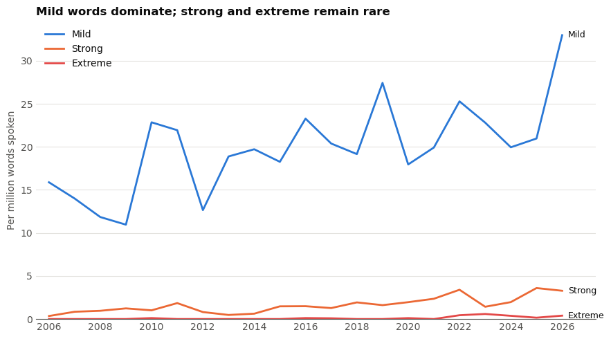
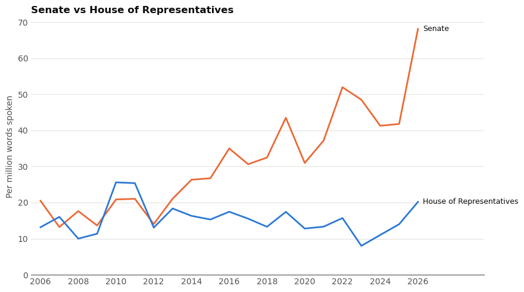
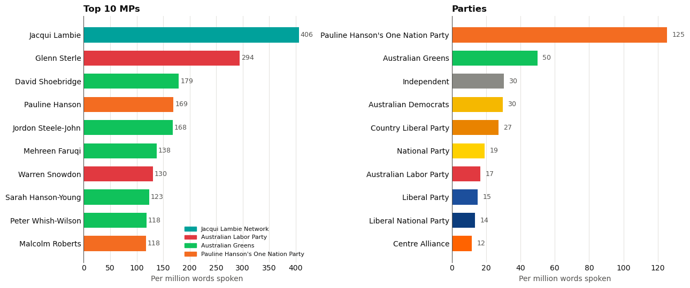
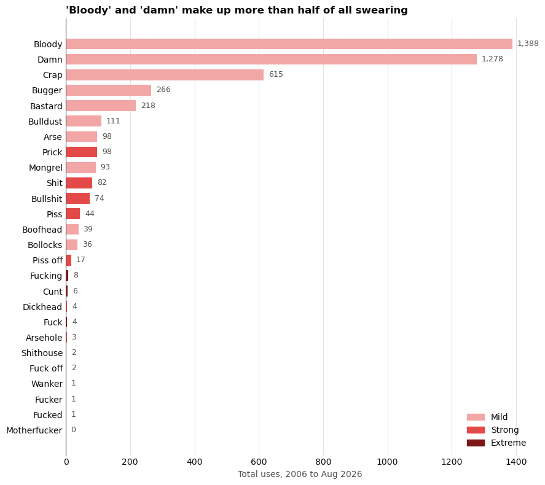

**Swearing in parliament**

Some MPs are allegedly swearing (and then not withdrawing the comments) to get kicked out of parliament for social media content

Separately, the attack on Helen Haines led to a discussion around vitriol directed at politicians, and whether it has gotten worse, needs to be toned down, etc.

So, how much do politicians swear, and has it increased? 

Questions:
- Has swearing changed over time?
- Who are the top offenders? Top 10 MPs by total number of words spoken and rate by party
- What words are most/least common?
- How many times are politicans quoting abuse directed towards them, versus those who are actually using swear words for their intended use?
- How does the use of swear words by politicans compare to those commonly used in popular TV (most popular Australian tv shows, movies, podcasts) or music?

Sources:
Speeches (to text) in the House of Representatives and the Senate, from Hansard via OpenAustralia. Roughly 700k speeches and 214m words

Notes: 
- Have used 26-word list of swear words pulled by Andy, as well as labels of severity - this includes words and their variants, eg. bastard, bastards
- Have differed from Andy's analysis by taking word use (by count) instead of speeches containing a word
- For standardisation, have created a measure per million words (to avoid discrepancies in sitting days per year distorting results)


```python
# setup
import sqlite3
import pandas as pd
from pathlib import Path
import numpy as np
import matplotlib.pyplot as plt

DB  = "/Users/hannah/Desktop/parliament-speeches.sqlite"
OUT = Path("/Users/hannah/Desktop/parliament-csv")   
OUT.mkdir(exist_ok=True)

con = sqlite3.connect(f"file:{DB}?mode=ro", uri=True)

for t in ["parliaments", "people", "swearing_terms", "swearing_hits"]:
    pd.read_sql(f"SELECT * FROM {t}", con).to_csv(OUT / f"{t}.csv", index=False)

# speeches without the body text, one row per speech
cols = [r[1] for r in con.execute("PRAGMA table_info(speeches)") if r[1] != "body_text"]
pd.read_sql(f"SELECT {', '.join(cols)} FROM speeches", con).to_csv(OUT / "speeches_meta.csv", index=False)

for f in sorted(OUT.glob("*.csv")):
    print(f.name, round(f.stat().st_size / 1e6, 1), "MB")
```

    parliaments.csv 0.0 MB
    people.csv 0.1 MB
    speeches_meta.csv 259.2 MB
    swearing_hits.csv 1.4 MB
    swearing_terms.csv 0.0 MB


```python
# convert to csv for reading in pandas 
hits     = pd.read_csv(OUT / "swearing_hits.csv", dtype={"gid": str})
people   = pd.read_csv(OUT / "people.csv")
terms    = pd.read_csv(OUT / "swearing_terms.csv")
speeches = pd.read_csv(OUT / "speeches_meta.csv", dtype={"gid": str})
```


```python
# cleanup
words = speeches.groupby("speech_year")["word_count"].sum().rename("words")

clean = hits[(hits.counted == 1) & (hits.in_quote == 0) & (hits.proper_noun == 0)]
n = clean.groupby(["speech_year", "severity"]).size().unstack(fill_value=0)
```


```python
# view sample rows
hits[["speech_date", "speaker_name", "term", "severity", "in_quote", "snippet"]].sample(10, random_state=1)
```


<div>
<style scoped>
    .dataframe tbody tr th:only-of-type {
        vertical-align: middle;
    }

    .dataframe tbody tr th {
        vertical-align: top;
    }

    .dataframe thead th {
        text-align: right;
    }
</style>
<table border="1" class="dataframe">
  <thead>
    <tr style="text-align: right;">
      <th></th>
      <th>speech_date</th>
      <th>speaker_name</th>
      <th>term</th>
      <th>severity</th>
      <th>in_quote</th>
      <th>snippet</th>
    </tr>
  </thead>
  <tbody>
    <tr>
      <th>749</th>
      <td>2012-02-13</td>
      <td>Craig Kelly</td>
      <td>Bastard</td>
      <td>mild</td>
      <td>1</td>
      <td>…bor member who votes for it. I call on the In...</td>
    </tr>
    <tr>
      <th>3226</th>
      <td>2017-08-14</td>
      <td>Nick Xenophon</td>
      <td>Damn</td>
      <td>mild</td>
      <td>0</td>
      <td>…ssed the Senate last week. When I spoke to he...</td>
    </tr>
    <tr>
      <th>3137</th>
      <td>2016-11-29</td>
      <td>Jacqui Lambie</td>
      <td>Crap</td>
      <td>mild</td>
      <td>0</td>
      <td>…to draft it and no matter how many amendments...</td>
    </tr>
    <tr>
      <th>2453</th>
      <td>2010-10-27</td>
      <td>Anne McEwen</td>
      <td>Crap</td>
      <td>mild</td>
      <td>0</td>
      <td>…and controlled by climate change deniers and ...</td>
    </tr>
    <tr>
      <th>4356</th>
      <td>2024-09-19</td>
      <td>David Shoebridge</td>
      <td>Bullshit</td>
      <td>strong</td>
      <td>0</td>
      <td>…al this and that—'Oh it was all meant to be c...</td>
    </tr>
    <tr>
      <th>836</th>
      <td>2012-11-28</td>
      <td>Andrew Wilkie</td>
      <td>Bastard</td>
      <td>mild</td>
      <td>0</td>
      <td>…ember about her gambling problem. In other wo...</td>
    </tr>
    <tr>
      <th>1342</th>
      <td>2017-05-10</td>
      <td>Nick Champion</td>
      <td>Bulldust</td>
      <td>mild</td>
      <td>0</td>
      <td>Not up his way? That is bulldust and you know it.</td>
    </tr>
    <tr>
      <th>2876</th>
      <td>2015-02-11</td>
      <td>Matthew Canavan</td>
      <td>Bloody</td>
      <td>mild</td>
      <td>0</td>
      <td>…it is a good idea. The example of the Labor P...</td>
    </tr>
    <tr>
      <th>62</th>
      <td>2006-10-16</td>
      <td>Kevin Rudd</td>
      <td>Damn</td>
      <td>mild</td>
      <td>0</td>
      <td>…comes to ritualistic use and abuse of nationa...</td>
    </tr>
    <tr>
      <th>1237</th>
      <td>2016-05-02</td>
      <td>Eric Hutchinson</td>
      <td>Damn</td>
      <td>mild</td>
      <td>0</td>
      <td>…that are providing these very important patho...</td>
    </tr>
  </tbody>
</table>
</div>


```python
# cleaning
import re, sqlite3, pandas as pd

DB  = "/Users/hannah/Desktop/parliament-speeches.sqlite"
con = sqlite3.connect(f"file:{DB}?mode=ro", uri=True)

terms = pd.read_sql("SELECT * FROM swearing_terms WHERE counted = 1", con)   # drops the 'Censored' row

# every spelling variant -> its term, and each term -> its severity
var2term = {v.strip().lower(): r.term for _, r in terms.iterrows() for v in r.variants.split(",")}
severity = dict(zip(terms.term, terms.severity))

# phrases that look like swearing but aren't, e.g. "bloody-minded"
excl = {e.strip().lower() for x in terms.excluded.dropna() for e in x.split(",") if e.strip()}

def alt(words):   # longest first, so "fuck off" is matched before "fuck"
    return "|".join(re.escape(w) for w in sorted(words, key=len, reverse=True))

pat   = re.compile(r"(?<!\w)(?:" + alt(var2term) + r")(?!\w)", re.I)
expat = re.compile(r"(?<!\w)(?:" + alt(excl) + r")(?!\w)", re.I)

rows = []
cur = con.execute("SELECT chamber, gid, speech_date, speech_year, person_id, speaker_name, party, body_text FROM speeches")
for ch, gid, d, y, pid, name, party, text in cur:
    matches = list(pat.finditer(text))
    if not matches:
        continue
    skip = [(m.start(), m.end()) for m in expat.finditer(text)]
    for m in matches:
        if any(s <= m.start() < e for s, e in skip):
            continue                                    # inside an excluded phrase
        tok  = m.group(0).lower()
        term = var2term[tok]
        rows.append((ch, gid, d, y, pid, name, party, term, severity[term], tok, m.start()))

scan = pd.DataFrame(rows, columns=["chamber", "gid", "date", "year", "person_id", "name",
                                   "party", "term", "severity", "token", "offset"])
scan["speech"] = scan.chamber + "|" + scan.gid
len(scan)   # 4489
```


    4489


**Has swearing changed over time? Top figures**

Swearing is up approximately 78% over the period of 2006-2026

The rise comes almost entirely from the Senate rather than the House of Representatives

0.5% of all speeches include a swear word

The rate (four-year average) in 2006-9 was 14. In 2022-5 it was 24.9.

The lowest year was 2009 (12.2). The highest year was 2022 (29.1).

While incomplete, 2026 so far has been the highest of any year (36.6). 

The five heaviest users (Jacqui Lambie, Glenn Sterle, Bill Heffernan, Peter Whish-Wilson, Pauline Hanson) account for 18% of all uses, and the top ten for 28%.

Over the time period, mild swear words make up the majority (92%). 7% are strong, 0.5% are extreme. But strong and extreme words combined rose 3.3 times, from 0.85 to 2.77 per million - a faster proportional rise than mild words.

Among people who spoke in each period, the share who swore at least once fell from 59% (173 of 293) to 50% (159 of 321). This means the rise isn't due to an increase in people swearing, but rather those who swear, swearing more. 

The Senate rate rose from about 14–21 per million words (2006–13) to about 41–52 (2022–25), while the House stayed flat. Crossbench and Greens senators drive the late period.


```python
per_million = n.div(words, axis=0) * 1e6
per_million["all"] = per_million.sum(axis=1)
per_million.round(1)
```


<div>
<style scoped>
    .dataframe tbody tr th:only-of-type {
        vertical-align: middle;
    }

    .dataframe tbody tr th {
        vertical-align: top;
    }

    .dataframe thead th {
        text-align: right;
    }
</style>
<table border="1" class="dataframe">
  <thead>
    <tr style="text-align: right;">
      <th>severity</th>
      <th>extreme</th>
      <th>mild</th>
      <th>strong</th>
      <th>all</th>
    </tr>
    <tr>
      <th>speech_year</th>
      <th></th>
      <th></th>
      <th></th>
      <th></th>
    </tr>
  </thead>
  <tbody>
    <tr>
      <th>2006</th>
      <td>0.0</td>
      <td>12.0</td>
      <td>0.3</td>
      <td>12.3</td>
    </tr>
    <tr>
      <th>2007</th>
      <td>0.0</td>
      <td>9.1</td>
      <td>0.6</td>
      <td>9.7</td>
    </tr>
    <tr>
      <th>2008</th>
      <td>0.0</td>
      <td>8.4</td>
      <td>0.7</td>
      <td>9.1</td>
    </tr>
    <tr>
      <th>2009</th>
      <td>0.0</td>
      <td>8.7</td>
      <td>0.9</td>
      <td>9.5</td>
    </tr>
    <tr>
      <th>2010</th>
      <td>0.0</td>
      <td>13.3</td>
      <td>0.7</td>
      <td>14.0</td>
    </tr>
    <tr>
      <th>2011</th>
      <td>0.0</td>
      <td>14.1</td>
      <td>1.2</td>
      <td>15.4</td>
    </tr>
    <tr>
      <th>2012</th>
      <td>0.0</td>
      <td>9.5</td>
      <td>0.7</td>
      <td>10.2</td>
    </tr>
    <tr>
      <th>2013</th>
      <td>0.0</td>
      <td>13.3</td>
      <td>0.4</td>
      <td>13.7</td>
    </tr>
    <tr>
      <th>2014</th>
      <td>0.0</td>
      <td>13.3</td>
      <td>0.4</td>
      <td>13.7</td>
    </tr>
    <tr>
      <th>2015</th>
      <td>0.0</td>
      <td>14.7</td>
      <td>1.1</td>
      <td>15.8</td>
    </tr>
    <tr>
      <th>2016</th>
      <td>0.1</td>
      <td>17.4</td>
      <td>1.3</td>
      <td>18.8</td>
    </tr>
    <tr>
      <th>2017</th>
      <td>0.0</td>
      <td>16.5</td>
      <td>0.7</td>
      <td>17.2</td>
    </tr>
    <tr>
      <th>2018</th>
      <td>0.0</td>
      <td>16.4</td>
      <td>1.6</td>
      <td>18.0</td>
    </tr>
    <tr>
      <th>2019</th>
      <td>0.0</td>
      <td>22.4</td>
      <td>0.9</td>
      <td>23.3</td>
    </tr>
    <tr>
      <th>2020</th>
      <td>0.0</td>
      <td>15.1</td>
      <td>1.6</td>
      <td>16.8</td>
    </tr>
    <tr>
      <th>2021</th>
      <td>0.0</td>
      <td>16.7</td>
      <td>1.7</td>
      <td>18.4</td>
    </tr>
    <tr>
      <th>2022</th>
      <td>0.1</td>
      <td>22.5</td>
      <td>2.2</td>
      <td>24.8</td>
    </tr>
    <tr>
      <th>2023</th>
      <td>0.3</td>
      <td>20.9</td>
      <td>1.3</td>
      <td>22.6</td>
    </tr>
    <tr>
      <th>2024</th>
      <td>0.1</td>
      <td>17.7</td>
      <td>1.4</td>
      <td>19.2</td>
    </tr>
    <tr>
      <th>2025</th>
      <td>0.0</td>
      <td>18.8</td>
      <td>2.8</td>
      <td>21.6</td>
    </tr>
    <tr>
      <th>2026</th>
      <td>0.3</td>
      <td>28.5</td>
      <td>2.5</td>
      <td>31.3</td>
    </tr>
  </tbody>
</table>
</div>


```python
# total words spoken each year 
words = speeches.groupby("speech_year")["word_count"].sum()

def per_million(df):
    """Hits per million words spoken, for each year."""
    return df.groupby("speech_year").size().reindex(words.index, fill_value=0) / words * 1e6

counted = hits[hits.counted == 1]
clean   = counted[(counted.in_quote == 0) & (counted.proper_noun == 0)]

all_counted = per_million(counted)                           
headline    = per_million(clean)                             
strong_up   = per_million(clean[clean.severity != "mild"])   

pd.DataFrame({"all": all_counted, "headline": headline, "strong_up": strong_up}).round(1).T
```


<div>
<style scoped>
    .dataframe tbody tr th:only-of-type {
        vertical-align: middle;
    }

    .dataframe tbody tr th {
        vertical-align: top;
    }

    .dataframe thead th {
        text-align: right;
    }
</style>
<table border="1" class="dataframe">
  <thead>
    <tr style="text-align: right;">
      <th>speech_year</th>
      <th>2006</th>
      <th>2007</th>
      <th>2008</th>
      <th>2009</th>
      <th>2010</th>
      <th>2011</th>
      <th>2012</th>
      <th>2013</th>
      <th>2014</th>
      <th>2015</th>
      <th>...</th>
      <th>2017</th>
      <th>2018</th>
      <th>2019</th>
      <th>2020</th>
      <th>2021</th>
      <th>2022</th>
      <th>2023</th>
      <th>2024</th>
      <th>2025</th>
      <th>2026</th>
    </tr>
  </thead>
  <tbody>
    <tr>
      <th>all</th>
      <td>16.2</td>
      <td>14.8</td>
      <td>12.8</td>
      <td>12.2</td>
      <td>24.0</td>
      <td>23.8</td>
      <td>13.5</td>
      <td>19.4</td>
      <td>20.3</td>
      <td>19.7</td>
      <td>...</td>
      <td>21.7</td>
      <td>21.1</td>
      <td>29.0</td>
      <td>20.0</td>
      <td>22.3</td>
      <td>29.1</td>
      <td>24.8</td>
      <td>22.3</td>
      <td>24.7</td>
      <td>36.6</td>
    </tr>
    <tr>
      <th>headline</th>
      <td>12.3</td>
      <td>9.7</td>
      <td>9.1</td>
      <td>9.5</td>
      <td>14.0</td>
      <td>15.4</td>
      <td>10.2</td>
      <td>13.7</td>
      <td>13.7</td>
      <td>15.8</td>
      <td>...</td>
      <td>17.2</td>
      <td>18.0</td>
      <td>23.3</td>
      <td>16.8</td>
      <td>18.4</td>
      <td>24.8</td>
      <td>22.6</td>
      <td>19.2</td>
      <td>21.6</td>
      <td>31.3</td>
    </tr>
    <tr>
      <th>strong_up</th>
      <td>0.3</td>
      <td>0.6</td>
      <td>0.7</td>
      <td>0.9</td>
      <td>0.7</td>
      <td>1.2</td>
      <td>0.7</td>
      <td>0.4</td>
      <td>0.4</td>
      <td>1.1</td>
      <td>...</td>
      <td>0.7</td>
      <td>1.6</td>
      <td>0.9</td>
      <td>1.6</td>
      <td>1.7</td>
      <td>2.4</td>
      <td>1.7</td>
      <td>1.5</td>
      <td>2.8</td>
      <td>2.8</td>
    </tr>
  </tbody>
</table>
<p>3 rows × 21 columns</p>
</div>


```python
words = speeches.groupby("speech_year")["word_count"].sum()

# card 1: all 26 words together, per million words spoken
total = scan.groupby("year").size().reindex(words.index, fill_value=0) / words * 1e6

# card 2: the same, split by severity
by_sev = (scan.groupby(["year", "severity"]).size().unstack(fill_value=0)
              .reindex(words.index, fill_value=0)
              .reindex(columns=["mild", "strong", "extreme"], fill_value=0)
              .div(words, axis=0) * 1e6)

BLUE, ORANGE, RED, INK, MUTED, GRID = "#2a78d6", "#eb6834", "#e34948", "#0b0b0b", "#52514e", "#e4e3df"

def style(ax):
    for s in ["top", "right", "left"]:
        ax.spines[s].set_visible(False)
    ax.spines["bottom"].set_color(MUTED)
    ax.grid(axis="y", color=GRID, lw=0.8)
    ax.set_axisbelow(True)
    ax.tick_params(length=0, colors=MUTED)
    ax.set_xticks(range(2006, 2027, 2))
```


```python
# total swearing chart w/ line of best fit
full = total.index < 2026
slope, intercept = np.polyfit(total.index[full], total[full], 1)

fig, ax = plt.subplots(figsize=(9, 5)); style(ax)
ax.plot(total.index[:-1], total.iloc[:-1], color=BLUE, lw=2, label="Swear words per million words")
ax.plot(total.index[-2:], total.iloc[-2:], color=BLUE, lw=2, ls=(0, (3, 3)))          # 2026 dashed: partial year
ax.scatter(total.index[:-1], total.iloc[:-1], s=25, color=BLUE, edgecolor="white", linewidth=1.5, zorder=3)
ax.scatter([2026], [total.iloc[-1]], s=25, facecolor="white", edgecolor=BLUE, linewidth=1.5, zorder=3)

x = np.array([2006, 2025])
ax.plot(x, slope * x + intercept, color=MUTED, lw=1.5, ls="--",
        label=f"Line of best fit, 2006–2025 (+{slope:.1f} per year)")
ax.annotate("2026: Jan–Aug only", (2026, total.iloc[-1]), xytext=(-8, 6),
            textcoords="offset points", ha="right", color=MUTED, fontsize=9)

ax.legend(frameon=False, loc="upper left", labelcolor=INK)
ax.set_ylabel("Per million words spoken", color=MUTED)
ax.set_title("Swearing in parliament has risen since 2006", loc="left", color=INK, fontweight="bold")
ax.set_ylim(bottom=0)
plt.tight_layout(); plt.show()
```


    

    


```python
fig, ax = plt.subplots(figsize=(9, 5)); style(ax)
for col, c in [("mild", BLUE), ("strong", ORANGE), ("extreme", RED)]:
    ax.plot(by_sev.index, by_sev[col], color=c, lw=2, label=col.capitalize())
    ax.annotate(col.capitalize(), (2026, by_sev[col].iloc[-1]), xytext=(6, 0),
                textcoords="offset points", va="center", color=INK, fontsize=9)

ax.set_xlim(2005.5, 2027.3)
ax.legend(frameon=False, loc="upper left", labelcolor=INK)
ax.set_ylabel("Per million words spoken", color=MUTED)
ax.set_title("Mild words dominate; strong and extreme remain rare", loc="left", color=INK, fontweight="bold")
ax.set_ylim(bottom=0)
plt.tight_layout(); plt.show()
```


    

    


```python
EARLY, LATE = (2006, 2009), (2022, 2025)      # four full years at each end

def rate(hits, spk, a, b):
    """Swear words per million words spoken, over years a..b."""
    h = hits[hits.year.between(a, b)].shape[0]
    w = spk[spk.speech_year.between(a, b)].word_count.sum()
    return h / w * 1e6

e, l = rate(scan, speeches, *EARLY), rate(scan, speeches, *LATE)
print(f"Overall: {e:.1f} -> {l:.1f} per million words (+{(l/e-1)*100:.0f}%)")

for ch in ["representatives", "senate"]:
    s, h = speeches[speeches.chamber == ch], scan[scan.chamber == ch]
    a, b = rate(h, s, *EARLY), rate(h, s, *LATE)
    print(f"{ch}: {a:.1f} -> {b:.1f} ({(b/a-1)*100:+.0f}%)")

top5 = scan.groupby("person_id").size().nlargest(5).index
a = rate(scan[~scan.person_id.isin(top5)], speeches[~speeches.person_id.isin(top5)], *EARLY)
b = rate(scan[~scan.person_id.isin(top5)], speeches[~speeches.person_id.isin(top5)], *LATE)
print(f"Excluding the top 5 swearers: {a:.1f} -> {b:.1f} ({(b/a-1)*100:+.0f}%)")

sev = scan.groupby(["year", "severity"]).size().unstack(fill_value=0)
for name, (a, b) in [("early", EARLY), ("late", LATE)]:
    w = speeches[speeches.speech_year.between(a, b)].word_count.sum()
    print(name, (sev.loc[a:b].sum() / w * 1e6).round(2).to_dict())
```

    Overall: 14.0 -> 24.9 per million words (+78%)
    representatives: 12.3 -> 11.5 (-6%)
    senate: 16.5 -> 45.9 (+177%)
    Excluding the top 5 swearers: 12.5 -> 18.7 (+50%)
    early {'extreme': 0.0, 'mild': 13.12, 'strong': 0.85}
    late {'extreme': 0.42, 'mild': 22.09, 'strong': 2.35}


```python
# Senate analysis
W = speeches.groupby(["speech_year", "chamber"]).word_count.sum().unstack()
H = scan.groupby(["year", "chamber"]).size().unstack(fill_value=0).reindex(W.index, fill_value=0)
by_chamber = H / W * 1e6

fig, ax = plt.subplots(figsize=(9, 5))
for s in ["top", "right", "left"]: ax.spines[s].set_visible(False)
ax.spines["bottom"].set_color(MUTED); ax.grid(axis="y", color=GRID, lw=0.8); ax.set_axisbelow(True)
ax.tick_params(length=0, colors=MUTED); ax.set_xticks(range(2006, 2027, 2))
for ch, c, label in [("senate", ORANGE, "Senate"), ("representatives", BLUE, "House of Representatives")]:
    ax.plot(by_chamber.index, by_chamber[ch], color=c, lw=2)
    ax.annotate(label, (2026, by_chamber[ch].iloc[-1]), xytext=(6, 0),
                textcoords="offset points", va="center", color=INK, fontsize=9)
ax.set_xlim(2005.5, 2029.5); ax.set_ylim(bottom=0)
ax.set_ylabel("Per million words spoken", color=MUTED)
ax.set_title("Senate vs House of Representatives", loc="left", color=INK, fontweight="bold")
plt.tight_layout(); plt.show()
```


    

    


```python
sen = scan[scan.chamber == "senate"]
for a, b in [(2006, 2009), (2022, 2025)]:
    h = sen[sen.year.between(a, b)]
    print(f"--- Senate {a}-{b}: {len(h)} uses ---")
    print(h.groupby("name").size().nlargest(6).to_string())
    print(h.groupby("party").size().nlargest(5).to_string())
```

    --- Senate 2006-2009: 275 uses ---
    name
    Bill Heffernan           43
    Andrew Bartlett          31
    Glenn Sterle             19
    Bob Brown                 9
    Natasha Stott Despoja     8
    Nigel Scullion            8
    party
    Liberal Party             105
    Australian Labor Party     77
    Australian Democrats       46
    Australian Greens          17
    National Party             14
    --- Senate 2022-2025: 637 uses ---
    name
    Jacqui Lambie         95
    Malcolm Roberts       70
    Pauline Hanson        57
    David Shoebridge      55
    Peter Whish-Wilson    37
    Glenn Sterle          30
    party
    Australian Greens                    193
    Pauline Hanson's One Nation Party    129
    Jacqui Lambie Network                106
    Australian Labor Party                80
    Liberal Party                         70


**Top swearing MPs and rate of swearing by party? Top figures**

Note: An MP must've spoken at least 250k words to exclude those who have spoken very little from skewing results

A small group of senators swear more than anyone else, whereas the rest of MPs sit close to the average.

Among the 312 MPs with 250,000 or more words, the typical individual (median) is 11 per million.

Only 28 of the 312 swear at more than twice the overall rate.

Jacqui Lambie's swear rate was 406 per million words, 19x the overall average. She is followed by Glenn Sterle, who has a rate of 294 or 14x the average.

Lambie alone is 6% of all uses. 

These top offenders all use mild language more than strong or extreme words. 

Since 2016, in the Senate, the Greens swear at about 4.3 times Labor’s rate and One Nation at about 6.3 times.” Both figures are against Labor’s 20.2

The ten MPs with the highest swearing rates account for more than a quarter of all swearing but only 3% of the total number of words spoken. 

The way the data has been collected means that each MP is assigned their party at the time of each speech, meaning that Lambie's earlier years sit under different labels.

The 250k word cutoff excludes some prime swearers, including Bill Heffernan (877 per million) and Derryn Hinch (398), both senators


```python
# IGNORE BUILD CELL
import re, sqlite3
import pandas as pd
from pathlib import Path

DB  = "/Users/hannah/Desktop/parliament-speeches.sqlite"
OUT = Path("/Users/hannah/Desktop/parliament-csv")

con = sqlite3.connect(f"file:{DB}?mode=ro", uri=True)

terms = pd.read_sql("SELECT * FROM swearing_terms WHERE counted = 1", con)   # drops the 'Censored' row

# every spelling variant -> its term, and each term -> its severity
var2term = {v.strip().lower(): r.term for _, r in terms.iterrows() for v in r.variants.split(",")}
severity = dict(zip(terms.term, terms.severity))

# phrases that look like swearing but aren't, e.g. "bloody-minded"
excl = {e.strip().lower() for x in terms.excluded.dropna() for e in x.split(",") if e.strip()}

def alt(words):   # longest first, so "fuck off" is matched before "fuck"
    return "|".join(re.escape(w) for w in sorted(words, key=len, reverse=True))

pat   = re.compile(r"(?<!\w)(?:" + alt(var2term) + r")(?!\w)", re.I)
expat = re.compile(r"(?<!\w)(?:" + alt(excl) + r")(?!\w)", re.I)

rows = []
cur = con.execute("SELECT chamber, gid, speech_date, speech_year, person_id, speaker_name, party, body_text FROM speeches")
for ch, gid, d, y, pid, name, party, text in cur:
    matches = list(pat.finditer(text))
    if not matches:
        continue
    skip = [(m.start(), m.end()) for m in expat.finditer(text)]
    for m in matches:
        if any(s <= m.start() < e for s, e in skip):
            continue                                    # inside an excluded phrase
        tok  = m.group(0).lower()
        term = var2term[tok]
        rows.append((ch, gid, d, y, pid, name, party, term, severity[term], tok, m.start()))

scan = pd.DataFrame(rows, columns=["chamber", "gid", "date", "year", "person_id", "name",
                                   "party", "term", "severity", "token", "offset"])
scan["speech"] = scan.chamber + "|" + scan.gid
print(len(scan))                                        # expect 4489

OUT.mkdir(exist_ok=True)
scan.to_csv(OUT / "scan26.csv", index=False)
print("saved:", OUT / "scan26.csv")
```

    4489
    saved: /Users/hannah/Desktop/parliament-csv/scan26.csv


```python
OUT = Path("/Users/hannah/Desktop/parliament-csv")      # folder holding your exported CSVs

def clean_ids(s):
    """Make person_id a clean text ID: '10001', never 10001.0 or 10001."""
    return s.astype("string").str.strip().str.replace(r"\.0$", "", regex=True)

speeches = pd.read_csv(OUT / "speeches_meta.csv", dtype={"gid": str, "person_id": str})
people   = pd.read_csv(OUT / "people.csv",        dtype={"person_id": str})
scan     = pd.read_csv(OUT / "scan26.csv",        dtype={"gid": str, "person_id": str})

for d in (speeches, people, scan):
    d["person_id"] = clean_ids(d["person_id"])

# safety checks: stop here if anything is off
print("scan:", scan.shape, "| speeches:", speeches.shape)
assert len(scan) == 4489 and len(speeches) == 701890, "unexpected row counts"
matched = scan.person_id.dropna().isin(set(people.person_id)).sum()
print("uses whose person_id is found in people:", matched, "(expect 4486)")
assert matched == 4486, "IDs still don't match: check the three person_id columns"
```

    scan: (4489, 12) | speeches: (701890, 17)
    uses whose person_id is found in people: 4486 (expect 4486)


```python
MIN_WORDS = 250_000

words = speeches.groupby("person_id").word_count.sum().rename("words")
uses  = scan.groupby("person_id").size().rename("uses")

mps = (people.set_index("person_id")[["speaker_name", "usual_party", "chamber"]]
             .join(words).join(uses).fillna({"uses": 0}))
mps["per_million"] = mps.uses / mps.words * 1e6

print("total uses attached to people:", mps.uses.sum(), "(expect 4486)")
top10 = mps[mps.words >= MIN_WORDS].nlargest(10, "per_million")
top10.round(1)
```

    total uses attached to people: 4486.0 (expect 4486)


<div>
<style scoped>
    .dataframe tbody tr th:only-of-type {
        vertical-align: middle;
    }

    .dataframe tbody tr th {
        vertical-align: top;
    }

    .dataframe thead th {
        text-align: right;
    }
</style>
<table border="1" class="dataframe">
  <thead>
    <tr style="text-align: right;">
      <th></th>
      <th>speaker_name</th>
      <th>usual_party</th>
      <th>chamber</th>
      <th>words</th>
      <th>uses</th>
      <th>per_million</th>
    </tr>
    <tr>
      <th>person_id</th>
      <th></th>
      <th></th>
      <th></th>
      <th></th>
      <th></th>
      <th></th>
    </tr>
  </thead>
  <tbody>
    <tr>
      <th>10830</th>
      <td>Jacqui Lambie</td>
      <td>Jacqui Lambie Network</td>
      <td>senate</td>
      <td>627664</td>
      <td>255.0</td>
      <td>406.3</td>
    </tr>
    <tr>
      <th>10610</th>
      <td>Glenn Sterle</td>
      <td>Australian Labor Party</td>
      <td>senate</td>
      <td>645623</td>
      <td>190.0</td>
      <td>294.3</td>
    </tr>
    <tr>
      <th>11010</th>
      <td>David Shoebridge</td>
      <td>Australian Greens</td>
      <td>senate</td>
      <td>462479</td>
      <td>83.0</td>
      <td>179.5</td>
    </tr>
    <tr>
      <th>10280</th>
      <td>Pauline Hanson</td>
      <td>Pauline Hanson's One Nation Party</td>
      <td>senate</td>
      <td>649137</td>
      <td>110.0</td>
      <td>169.5</td>
    </tr>
    <tr>
      <th>10901</th>
      <td>Jordon Steele-John</td>
      <td>Australian Greens</td>
      <td>senate</td>
      <td>410811</td>
      <td>69.0</td>
      <td>168.0</td>
    </tr>
    <tr>
      <th>10912</th>
      <td>Mehreen Faruqi</td>
      <td>Australian Greens</td>
      <td>senate</td>
      <td>464361</td>
      <td>64.0</td>
      <td>137.8</td>
    </tr>
    <tr>
      <th>10599</th>
      <td>Warren Snowdon</td>
      <td>Australian Labor Party</td>
      <td>representatives</td>
      <td>712754</td>
      <td>93.0</td>
      <td>130.5</td>
    </tr>
    <tr>
      <th>10711</th>
      <td>Sarah Hanson-Young</td>
      <td>Australian Greens</td>
      <td>senate</td>
      <td>843238</td>
      <td>104.0</td>
      <td>123.3</td>
    </tr>
    <tr>
      <th>10780</th>
      <td>Peter Whish-Wilson</td>
      <td>Australian Greens</td>
      <td>senate</td>
      <td>996370</td>
      <td>118.0</td>
      <td>118.4</td>
    </tr>
    <tr>
      <th>10856</th>
      <td>Malcolm Roberts</td>
      <td>Pauline Hanson's One Nation Party</td>
      <td>senate</td>
      <td>883842</td>
      <td>104.0</td>
      <td>117.7</td>
    </tr>
  </tbody>
</table>
</div>


```python
# top 10 MPs
MIN_WORDS = 250_000

words = speeches.groupby("person_id").word_count.sum().rename("words")
uses  = scan.groupby("person_id").size().rename("uses")

mps = (people.set_index("person_id")[["speaker_name", "usual_party", "chamber"]]
             .join(words).join(uses).fillna({"uses": 0}))
mps["per_million"] = mps.uses / mps.words * 1e6

top10 = mps[mps.words >= MIN_WORDS].nlargest(10, "per_million")
top10.round(1)
```


<div>
<style scoped>
    .dataframe tbody tr th:only-of-type {
        vertical-align: middle;
    }

    .dataframe tbody tr th {
        vertical-align: top;
    }

    .dataframe thead th {
        text-align: right;
    }
</style>
<table border="1" class="dataframe">
  <thead>
    <tr style="text-align: right;">
      <th></th>
      <th>speaker_name</th>
      <th>usual_party</th>
      <th>chamber</th>
      <th>words</th>
      <th>uses</th>
      <th>per_million</th>
    </tr>
    <tr>
      <th>person_id</th>
      <th></th>
      <th></th>
      <th></th>
      <th></th>
      <th></th>
      <th></th>
    </tr>
  </thead>
  <tbody>
    <tr>
      <th>10001.0</th>
      <td>Tony Abbott</td>
      <td>Liberal Party</td>
      <td>representatives</td>
      <td>765301</td>
      <td>0.0</td>
      <td>0.0</td>
    </tr>
    <tr>
      <th>10003.0</th>
      <td>Eric Abetz</td>
      <td>Liberal Party</td>
      <td>senate</td>
      <td>1259534</td>
      <td>0.0</td>
      <td>0.0</td>
    </tr>
    <tr>
      <th>10004.0</th>
      <td>Dick Adams</td>
      <td>Australian Labor Party</td>
      <td>representatives</td>
      <td>282877</td>
      <td>0.0</td>
      <td>0.0</td>
    </tr>
    <tr>
      <th>10007.0</th>
      <td>Anthony Albanese</td>
      <td>Australian Labor Party</td>
      <td>representatives</td>
      <td>2105287</td>
      <td>0.0</td>
      <td>0.0</td>
    </tr>
    <tr>
      <th>10009.0</th>
      <td>Lyn Allison</td>
      <td>Australian Democrats</td>
      <td>senate</td>
      <td>283873</td>
      <td>0.0</td>
      <td>0.0</td>
    </tr>
    <tr>
      <th>10014.0</th>
      <td>Kevin Andrews</td>
      <td>Liberal Party</td>
      <td>representatives</td>
      <td>392362</td>
      <td>0.0</td>
      <td>0.0</td>
    </tr>
    <tr>
      <th>10026.0</th>
      <td>Bob Baldwin</td>
      <td>Liberal Party</td>
      <td>representatives</td>
      <td>603618</td>
      <td>0.0</td>
      <td>0.0</td>
    </tr>
    <tr>
      <th>10027.0</th>
      <td>Guy Barnett</td>
      <td>Liberal Party</td>
      <td>senate</td>
      <td>350266</td>
      <td>0.0</td>
      <td>0.0</td>
    </tr>
    <tr>
      <th>10029.0</th>
      <td>Andrew Bartlett</td>
      <td>Australian Democrats</td>
      <td>senate</td>
      <td>785966</td>
      <td>0.0</td>
      <td>0.0</td>
    </tr>
    <tr>
      <th>10038.0</th>
      <td>Cory Bernardi</td>
      <td>Liberal Party</td>
      <td>senate</td>
      <td>654363</td>
      <td>0.0</td>
      <td>0.0</td>
    </tr>
  </tbody>
</table>
</div>


```python
# rate by party
PRESIDING = ["Speaker", "Deputy-Speaker", "President", "Deputy-President"]
MIN_PARTY_WORDS = 500_000

spk = speeches[speeches.party.notna() & ~speeches.party.isin(PRESIDING)]
pw = spk.groupby("party").word_count.sum().rename("words")
pu = scan[scan.party.notna() & ~scan.party.isin(PRESIDING)].groupby("party").size().rename("uses")

parties = pd.concat([pw, pu], axis=1).fillna(0)
parties["per_million"] = parties.uses / parties.words * 1e6
parties = parties[parties.words >= MIN_PARTY_WORDS].sort_values("per_million", ascending=False)
parties.round(1)
```


<div>
<style scoped>
    .dataframe tbody tr th:only-of-type {
        vertical-align: middle;
    }

    .dataframe tbody tr th {
        vertical-align: top;
    }

    .dataframe thead th {
        text-align: right;
    }
</style>
<table border="1" class="dataframe">
  <thead>
    <tr style="text-align: right;">
      <th></th>
      <th>words</th>
      <th>uses</th>
      <th>per_million</th>
    </tr>
    <tr>
      <th>party</th>
      <th></th>
      <th></th>
      <th></th>
    </tr>
  </thead>
  <tbody>
    <tr>
      <th>Pauline Hanson's One Nation Party</th>
      <td>1737370</td>
      <td>218.0</td>
      <td>125.5</td>
    </tr>
    <tr>
      <th>Australian Greens</th>
      <td>14395148</td>
      <td>718.0</td>
      <td>49.9</td>
    </tr>
    <tr>
      <th>Independent</th>
      <td>7429149</td>
      <td>224.0</td>
      <td>30.2</td>
    </tr>
    <tr>
      <th>Australian Democrats</th>
      <td>1555462</td>
      <td>46.0</td>
      <td>29.6</td>
    </tr>
    <tr>
      <th>Country Liberal Party</th>
      <td>1220436</td>
      <td>33.0</td>
      <td>27.0</td>
    </tr>
    <tr>
      <th>National Party</th>
      <td>13784403</td>
      <td>261.0</td>
      <td>18.9</td>
    </tr>
    <tr>
      <th>Australian Labor Party</th>
      <td>93585415</td>
      <td>1550.0</td>
      <td>16.6</td>
    </tr>
    <tr>
      <th>Liberal Party</th>
      <td>69464364</td>
      <td>1053.0</td>
      <td>15.2</td>
    </tr>
    <tr>
      <th>Liberal National Party</th>
      <td>3168593</td>
      <td>43.0</td>
      <td>13.6</td>
    </tr>
    <tr>
      <th>Centre Alliance</th>
      <td>771827</td>
      <td>9.0</td>
      <td>11.7</td>
    </tr>
  </tbody>
</table>
</div>


```python
# plot top 10 MPs and rate per party
PARTY_COLOURS = {
    "Australian Labor Party":            "#E13940",
    "Liberal Party":                     "#1C4F9C",
    "Liberal National Party":            "#0B3C7D",
    "National Party":                    "#FFD100",
    "Australian Greens":                 "#10C25B",
    "Pauline Hanson's One Nation Party": "#F36C21",
    "Jacqui Lambie Network":             "#00A19B",
    "Palmer United Party":               "#FFC20E",
    "Australian Democrats":              "#F5B800",
    "Country Liberal Party":             "#E98300",
    "Centre Alliance":                   "#FF6300",
    "Derryn Hinch's Justice Party":      "#7A3E9D",
    "Independent":                       "#8A8A85",
}
FALLBACK = "#8A8A85"          # any party not listed above
def colour(party): return PARTY_COLOURS.get(party, FALLBACK)

# each person's most recent party: their last speech not made as Speaker/President etc.
PRESIDING = ["Speaker", "Deputy-Speaker", "President", "Deputy-President"]
recent = (speeches[speeches.person_id.notna() & speeches.party.notna() & ~speeches.party.isin(PRESIDING)]
          .sort_values("speech_date").groupby("person_id").party.last().rename("recent_party"))
top10 = top10.join(recent)
print(top10[["speaker_name", "usual_party", "recent_party"]])   # check the assignments

INK, MUTED, GRID = "#0b0b0b", "#52514e", "#e4e3df"
fig, axes = plt.subplots(1, 2, figsize=(13, 5.5))
panels = [(axes[0], top10.iloc[::-1], "speaker_name", "recent_party", "Top 10 MPs"),
          (axes[1], parties.iloc[::-1], None, None, "Parties")]
for ax, d, lab, pcol, title in panels:
    for s in ["top", "right", "bottom"]:
        ax.spines[s].set_visible(False)
    ax.spines["left"].set_color(MUTED); ax.tick_params(length=0, colors=INK)
    ax.xaxis.grid(True, color=GRID, lw=0.8); ax.set_axisbelow(True)
    names  = d[lab] if lab else d.index
    colors = [colour(p) for p in (d[pcol] if pcol else d.index)]
    bars = ax.barh(names, d.per_million, color=colors, height=0.65)
    for b, v in zip(bars, d.per_million):
        ax.text(v + 3, b.get_y() + b.get_height() / 2, f"{v:.0f}", va="center", color=MUTED, fontsize=9)
    ax.set_title(title, loc="left", color=INK, fontweight="bold")
    ax.set_xlabel("Per million words spoken", color=MUTED)

# legend for the MP panel, in rank order
from matplotlib.patches import Patch
used = list(dict.fromkeys(top10.sort_values("per_million", ascending=False).recent_party))
axes[0].legend(handles=[Patch(color=colour(p), label=p) for p in used],
               frameon=False, loc="lower right", fontsize=8, labelcolor=INK)
plt.tight_layout(); plt.show()
```

                     speaker_name                        usual_party  \
    person_id                                                          
    10830           Jacqui Lambie              Jacqui Lambie Network   
    10610            Glenn Sterle             Australian Labor Party   
    11010        David Shoebridge                  Australian Greens   
    10280          Pauline Hanson  Pauline Hanson's One Nation Party   
    10901      Jordon Steele-John                  Australian Greens   
    10912          Mehreen Faruqi                  Australian Greens   
    10599          Warren Snowdon             Australian Labor Party   
    10711      Sarah Hanson-Young                  Australian Greens   
    10780      Peter Whish-Wilson                  Australian Greens   
    10856         Malcolm Roberts  Pauline Hanson's One Nation Party   
    
                                    recent_party  
    person_id                                     
    10830                  Jacqui Lambie Network  
    10610                 Australian Labor Party  
    11010                      Australian Greens  
    10280      Pauline Hanson's One Nation Party  
    10901                      Australian Greens  
    10912                      Australian Greens  
    10599                 Australian Labor Party  
    10711                      Australian Greens  
    10780                      Australian Greens  
    10856      Pauline Hanson's One Nation Party  


    

    


**What words are most popular? Top lines**

The top 5 words are:
1. Bloody (6.5/mil words)
2. Damn (6.0/mil words)
3. Crap (2.9/mil words)
4. Bugger (1.2/mil words)
5. Bastard (1.0/mil words)

"Bloody" and "damn" together making up 59% of all uses.


```python
terms = pd.read_csv(OUT / "swearing_terms.csv")
terms = terms[terms.counted == 1]

total_words = speeches.word_count.sum()
scan["speech"] = scan.chamber + "|" + scan.gid

freq = (scan.groupby("term").agg(uses=("speech", "size"), speeches=("speech", "nunique"))
            .reindex(terms.term, fill_value=0))          # keeps terms with zero uses
freq["severity"]    = terms.set_index("term").severity
freq["share_%"]     = freq.uses / freq.uses.sum() * 100
freq["per_million"] = freq.uses / total_words * 1e6
freq = freq.sort_values("uses", ascending=False)
freq.round(2)
```


<div>
<style scoped>
    .dataframe tbody tr th:only-of-type {
        vertical-align: middle;
    }

    .dataframe tbody tr th {
        vertical-align: top;
    }

    .dataframe thead th {
        text-align: right;
    }
</style>
<table border="1" class="dataframe">
  <thead>
    <tr style="text-align: right;">
      <th></th>
      <th>uses</th>
      <th>speeches</th>
      <th>severity</th>
      <th>share_%</th>
      <th>per_million</th>
    </tr>
    <tr>
      <th>term</th>
      <th></th>
      <th></th>
      <th></th>
      <th></th>
      <th></th>
    </tr>
  </thead>
  <tbody>
    <tr>
      <th>Bloody</th>
      <td>1388</td>
      <td>1194</td>
      <td>mild</td>
      <td>30.92</td>
      <td>6.49</td>
    </tr>
    <tr>
      <th>Damn</th>
      <td>1278</td>
      <td>1149</td>
      <td>mild</td>
      <td>28.47</td>
      <td>5.97</td>
    </tr>
    <tr>
      <th>Crap</th>
      <td>615</td>
      <td>513</td>
      <td>mild</td>
      <td>13.70</td>
      <td>2.87</td>
    </tr>
    <tr>
      <th>Bugger</th>
      <td>266</td>
      <td>240</td>
      <td>mild</td>
      <td>5.93</td>
      <td>1.24</td>
    </tr>
    <tr>
      <th>Bastard</th>
      <td>218</td>
      <td>152</td>
      <td>mild</td>
      <td>4.86</td>
      <td>1.02</td>
    </tr>
    <tr>
      <th>Bulldust</th>
      <td>111</td>
      <td>94</td>
      <td>mild</td>
      <td>2.47</td>
      <td>0.52</td>
    </tr>
    <tr>
      <th>Arse</th>
      <td>98</td>
      <td>92</td>
      <td>mild</td>
      <td>2.18</td>
      <td>0.46</td>
    </tr>
    <tr>
      <th>Prick</th>
      <td>98</td>
      <td>85</td>
      <td>strong</td>
      <td>2.18</td>
      <td>0.46</td>
    </tr>
    <tr>
      <th>Mongrel</th>
      <td>93</td>
      <td>75</td>
      <td>mild</td>
      <td>2.07</td>
      <td>0.43</td>
    </tr>
    <tr>
      <th>Shit</th>
      <td>82</td>
      <td>76</td>
      <td>strong</td>
      <td>1.83</td>
      <td>0.38</td>
    </tr>
    <tr>
      <th>Bullshit</th>
      <td>74</td>
      <td>68</td>
      <td>strong</td>
      <td>1.65</td>
      <td>0.35</td>
    </tr>
    <tr>
      <th>Piss</th>
      <td>44</td>
      <td>40</td>
      <td>strong</td>
      <td>0.98</td>
      <td>0.21</td>
    </tr>
    <tr>
      <th>Boofhead</th>
      <td>39</td>
      <td>38</td>
      <td>mild</td>
      <td>0.87</td>
      <td>0.18</td>
    </tr>
    <tr>
      <th>Bollocks</th>
      <td>36</td>
      <td>33</td>
      <td>mild</td>
      <td>0.80</td>
      <td>0.17</td>
    </tr>
    <tr>
      <th>Piss off</th>
      <td>17</td>
      <td>14</td>
      <td>strong</td>
      <td>0.38</td>
      <td>0.08</td>
    </tr>
    <tr>
      <th>Fucking</th>
      <td>8</td>
      <td>7</td>
      <td>extreme</td>
      <td>0.18</td>
      <td>0.04</td>
    </tr>
    <tr>
      <th>Cunt</th>
      <td>6</td>
      <td>4</td>
      <td>extreme</td>
      <td>0.13</td>
      <td>0.03</td>
    </tr>
    <tr>
      <th>Dickhead</th>
      <td>4</td>
      <td>4</td>
      <td>strong</td>
      <td>0.09</td>
      <td>0.02</td>
    </tr>
    <tr>
      <th>Fuck</th>
      <td>4</td>
      <td>4</td>
      <td>extreme</td>
      <td>0.09</td>
      <td>0.02</td>
    </tr>
    <tr>
      <th>Arsehole</th>
      <td>3</td>
      <td>3</td>
      <td>strong</td>
      <td>0.07</td>
      <td>0.01</td>
    </tr>
    <tr>
      <th>Shithouse</th>
      <td>2</td>
      <td>2</td>
      <td>strong</td>
      <td>0.04</td>
      <td>0.01</td>
    </tr>
    <tr>
      <th>Fuck off</th>
      <td>2</td>
      <td>2</td>
      <td>extreme</td>
      <td>0.04</td>
      <td>0.01</td>
    </tr>
    <tr>
      <th>Wanker</th>
      <td>1</td>
      <td>1</td>
      <td>strong</td>
      <td>0.02</td>
      <td>0.00</td>
    </tr>
    <tr>
      <th>Fucker</th>
      <td>1</td>
      <td>1</td>
      <td>extreme</td>
      <td>0.02</td>
      <td>0.00</td>
    </tr>
    <tr>
      <th>Fucked</th>
      <td>1</td>
      <td>1</td>
      <td>extreme</td>
      <td>0.02</td>
      <td>0.00</td>
    </tr>
    <tr>
      <th>Motherfucker</th>
      <td>0</td>
      <td>0</td>
      <td>extreme</td>
      <td>0.00</td>
      <td>0.00</td>
    </tr>
  </tbody>
</table>
</div>


```python
from matplotlib.patches import Patch
SEV = {"mild": "#f3a6a6", "strong": "#e34948", "extreme": "#7d1616"}
INK, MUTED, GRID = "#0b0b0b", "#52514e", "#e4e3df"

d = freq.iloc[::-1]
fig, ax = plt.subplots(figsize=(9, 8))
for s in ["top", "right", "bottom"]:
    ax.spines[s].set_visible(False)
ax.spines["left"].set_color(MUTED); ax.tick_params(length=0, colors=INK)
ax.xaxis.grid(True, color=GRID, lw=0.8); ax.set_axisbelow(True)
bars = ax.barh(d.index, d.uses, color=[SEV[s] for s in d.severity], height=0.7)
for b, v in zip(bars, d.uses):
    ax.text(v + 15, b.get_y() + b.get_height() / 2, f"{v:,}", va="center", color=MUTED, fontsize=9)
ax.legend(handles=[Patch(color=c, label=k.capitalize()) for k, c in SEV.items()],
          frameon=False, loc="lower right", labelcolor=INK)
ax.set_xlabel("Total uses, 2006 to Aug 2026", color=MUTED)
ax.set_title("'Bloody' and 'damn' make up more than half of all swearing",
             loc="left", color=INK, fontweight="bold")
plt.tight_layout(); plt.show()
```


    

    


**How often are politicans swearing for the purpose of swearing (ie. uses of the words that are intentionally reactionary rather than quoting abuse aimed at them, the party or somebody else)? Top lines**

**NOTE: LLM ANALYSIS USED IN THIS INSTANCE**


```python
%pip install anthropic
```

    Collecting anthropic
      Obtaining dependency information for anthropic from https://files.pythonhosted.org/packages/96/8e/f8ef271dcbe3b187879b660c129ee36ef655c7b878f6878460891d9b2a26/anthropic-2.8.0-py3-none-any.whl.metadata
      Downloading anthropic-2.8.0-py3-none-any.whl.metadata (3.6 kB)
    Collecting anyio<5,>=4.1.0 (from anthropic)
      Obtaining dependency information for anyio<5,>=4.1.0 from https://files.pythonhosted.org/packages/a9/16/7757fb84c819accc7d7e9af5291b261e4abb8627ee040f99e7d35ef2457a/anyio-4.16.0-py3-none-any.whl.metadata
      Downloading anyio-4.16.0-py3-none-any.whl.metadata (4.7 kB)
    Collecting docstring-parser<1,>=0.15 (from anthropic)
      Obtaining dependency information for docstring-parser<1,>=0.15 from https://files.pythonhosted.org/packages/a7/5f/ed01f9a3cdffbd5a008556fc7b2a08ddb1cc6ace7effa7340604b1d16699/docstring_parser-0.18.0-py3-none-any.whl.metadata
      Downloading docstring_parser-0.18.0-py3-none-any.whl.metadata (3.5 kB)
    Collecting httpx2<3,>=2.0.0 (from anthropic)
      Obtaining dependency information for httpx2<3,>=2.0.0 from https://files.pythonhosted.org/packages/7b/3d/2e4bc4fd1ef9770871669adb348d612a6e4786b303a23f9935b81c48dd60/httpx2-2.16.0-py3-none-any.whl.metadata
      Downloading httpx2-2.16.0-py3-none-any.whl.metadata (10 kB)
    Collecting jiter<1,>=0.4.0 (from anthropic)
      Obtaining dependency information for jiter<1,>=0.4.0 from https://files.pythonhosted.org/packages/25/c5/3f98ccee535b6481fc401c594d23e07ca400d940ea8f9100a06262e07d66/jiter-0.19.0-cp311-cp311-macosx_10_12_x86_64.whl.metadata
      Downloading jiter-0.19.0-cp311-cp311-macosx_10_12_x86_64.whl.metadata (5.2 kB)
    Collecting opentelemetry-api<2,>=1.1.0 (from anthropic)
      Obtaining dependency information for opentelemetry-api<2,>=1.1.0 from https://files.pythonhosted.org/packages/a9/2d/610db864d7513158cebb8f36cc88e67e73bd6c7aa1905ef18d89e1281c81/opentelemetry_api-1.45.2-py3-none-any.whl.metadata
      Downloading opentelemetry_api-1.45.2-py3-none-any.whl.metadata (1.4 kB)
    Requirement already satisfied: pydantic<3,>=1.10.0 in ./anaconda3/lib/python3.11/site-packages (from anthropic) (1.10.8)
    Requirement already satisfied: sniffio<2,>=1 in ./anaconda3/lib/python3.11/site-packages (from anthropic) (1.3.1)
    Collecting typing-extensions<5,>=4.14 (from anthropic)
      Obtaining dependency information for typing-extensions<5,>=4.14 from https://files.pythonhosted.org/packages/49/d3/b8441a820a491ddfc024b0b0cf0393375b75ea13866d9c66727e54c2fc80/typing_extensions-4.16.0-py3-none-any.whl.metadata
      Downloading typing_extensions-4.16.0-py3-none-any.whl.metadata (3.3 kB)
    Requirement already satisfied: idna>=2.8 in ./anaconda3/lib/python3.11/site-packages (from anyio<5,>=4.1.0->anthropic) (3.4)
    Collecting httpcore2==2.16.0 (from httpx2<3,>=2.0.0->anthropic)
      Obtaining dependency information for httpcore2==2.16.0 from https://files.pythonhosted.org/packages/af/c2/ce417c397afa5181f0e3c6ff01a4d01639414e1adef08730d97571297151/httpcore2-2.16.0-py3-none-any.whl.metadata
      Downloading httpcore2-2.16.0-py3-none-any.whl.metadata (27 kB)
    Collecting idna>=2.8 (from anyio<5,>=4.1.0->anthropic)
      Obtaining dependency information for idna>=2.8 from https://files.pythonhosted.org/packages/58/a2/bb081bab032533a855d44de1d56f8e8426114ff1ba5d1f07a438a0a654f8/idna-3.20-py3-none-any.whl.metadata
      Downloading idna-3.20-py3-none-any.whl.metadata (7.2 kB)
    Collecting truststore>=0.10 (from httpx2<3,>=2.0.0->anthropic)
      Obtaining dependency information for truststore>=0.10 from https://files.pythonhosted.org/packages/51/e9/3a7820be2bb0fe53b6bc9c3be26d3d1158004e4c3ab953aa6840b955b1e9/truststore-0.10.5-py3-none-any.whl.metadata
      Downloading truststore-0.10.5-py3-none-any.whl.metadata (4.5 kB)
    Collecting h11>=0.16 (from httpcore2==2.16.0->httpx2<3,>=2.0.0->anthropic)
      Obtaining dependency information for h11>=0.16 from https://files.pythonhosted.org/packages/04/4b/29cac41a4d98d144bf5f6d33995617b185d14b22401f75ca86f384e87ff1/h11-0.16.0-py3-none-any.whl.metadata
      Downloading h11-0.16.0-py3-none-any.whl.metadata (8.3 kB)
    Downloading anthropic-2.8.0-py3-none-any.whl (2.5 MB)
       ━━━━━━━━━━━━━━━━━━━━━━━━━━━━━━━━━━━━━━━━ 2.5/2.5 MB 26.6 MB/s eta 0:00:00 MB/s eta 0:00:01
    [?25hDownloading anyio-4.16.0-py3-none-any.whl (134 kB)
       ━━━━━━━━━━━━━━━━━━━━━━━━━━━━━━━━━━━━━━━━ 134.5/134.5 kB 16.6 MB/s eta 0:00:00
    [?25hDownloading docstring_parser-0.18.0-py3-none-any.whl (22 kB)
    Downloading httpx2-2.16.0-py3-none-any.whl (97 kB)
       ━━━━━━━━━━━━━━━━━━━━━━━━━━━━━━━━━━━━━━━━ 97.9/97.9 kB 12.2 MB/s eta 0:00:00
    [?25hDownloading httpcore2-2.16.0-py3-none-any.whl (85 kB)
       ━━━━━━━━━━━━━━━━━━━━━━━━━━━━━━━━━━━━━━━━ 85.1/85.1 kB 13.5 MB/s eta 0:00:00
    [?25hDownloading jiter-0.19.0-cp311-cp311-macosx_10_12_x86_64.whl (289 kB)
       ━━━━━━━━━━━━━━━━━━━━━━━━━━━━━━━━━━━━━━━━ 289.4/289.4 kB 26.4 MB/s eta 0:00:00
    [?25hDownloading opentelemetry_api-1.45.2-py3-none-any.whl (60 kB)
       ━━━━━━━━━━━━━━━━━━━━━━━━━━━━━━━━━━━━━━━━ 60.3/60.3 kB 8.6 MB/s eta 0:00:00
    [?25hDownloading typing_extensions-4.16.0-py3-none-any.whl (45 kB)
       ━━━━━━━━━━━━━━━━━━━━━━━━━━━━━━━━━━━━━━━━ 45.6/45.6 kB 12.6 MB/s eta 0:00:00
    [?25hDownloading idna-3.20-py3-none-any.whl (69 kB)
       ━━━━━━━━━━━━━━━━━━━━━━━━━━━━━━━━━━━━━━━━ 69.6/69.6 kB 12.4 MB/s eta 0:00:00
    [?25hDownloading truststore-0.10.5-py3-none-any.whl (19 kB)
    Downloading h11-0.16.0-py3-none-any.whl (37 kB)
    Installing collected packages: typing-extensions, truststore, jiter, idna, h11, docstring-parser, opentelemetry-api, httpcore2, anyio, httpx2, anthropic
      Attempting uninstall: typing-extensions
        Found existing installation: typing_extensions 4.12.2
        Uninstalling typing_extensions-4.12.2:
          Successfully uninstalled typing_extensions-4.12.2
      Attempting uninstall: idna
        Found existing installation: idna 3.4
        Uninstalling idna-3.4:
          Successfully uninstalled idna-3.4
      Attempting uninstall: h11
        Found existing installation: h11 0.14.0
        Uninstalling h11-0.14.0:
          Successfully uninstalled h11-0.14.0
      Attempting uninstall: anyio
        Found existing installation: anyio 3.5.0
        Uninstalling anyio-3.5.0:
          Successfully uninstalled anyio-3.5.0
    ERROR: pip's dependency resolver does not currently take into account all the packages that are installed. This behaviour is the source of the following dependency conflicts.
    jupyter-server 1.23.4 requires anyio<4,>=3.1.0, but you have anyio 4.16.0 which is incompatible.
    Successfully installed anthropic-2.8.0 anyio-4.16.0 docstring-parser-0.18.0 h11-0.16.0 httpcore2-2.16.0 httpx2-2.16.0 idna-3.20 jiter-0.19.0 opentelemetry-api-1.45.2 truststore-0.10.5 typing-extensions-4.16.0
    Note: you may need to restart the kernel to use updated packages.


```python
# ===== CELL 1: imports, connection, contexts (takes ~2-3 min) =====
import json, re, time, sqlite3
import pandas as pd
from concurrent.futures import ThreadPoolExecutor

DB  = "/Users/hannah/Desktop/parliament-speeches.sqlite"
con = sqlite3.connect(f"file:{DB}?mode=ro", uri=True)

def build_contexts(scan, con, before=400, after=250):
    """One record per swear-word use: surrounding text plus the previous speech in the same debate."""
    scan = scan.sort_values(["chamber", "gid", "offset"]).reset_index(drop=True)
    need = set(zip(scan.chamber, scan.gid))
    meta, subs = {}, {}
    q = ("SELECT chamber, gid, speaker_name, party, speech_date, section_title, subsection_gid, hpos, body_text "
         "FROM speeches")
    for ch, gid, nm, pa, d, sec, sg, hp, txt in con.execute(q):
        if (ch, gid) in need:
            meta[(ch, gid)] = (nm, pa, d, sec, sg, hp, txt)
        if sg is not None:
            subs.setdefault((ch, sg), []).append((hp if hp is not None else -1, nm, pa, txt[-350:]))
    out = []
    for i, h in scan.iterrows():
        nm, pa, d, sec, sg, hp, txt = meta[(h.chamber, h.gid)]
        o, e = int(h.offset), int(h.offset) + len(h.token)
        ctx = (("…" if o > before else "") + txt[max(0, o - before):o] + "[[" + txt[o:e] + "]]"
               + txt[e:e + after] + ("…" if e + after < len(txt) else ""))
        prev = None
        if sg is not None and hp is not None:
            c = [x for x in subs.get((h.chamber, sg), []) if x[0] < hp]
            if c:
                x = max(c, key=lambda t: t[0])
                prev = {"speaker": x[1], "party": x[2], "end_of_speech": x[3]}
        out.append({"id": i, "chamber": h.chamber, "gid": h.gid, "offset": o, "term": h.term,
                    "speaker": nm, "party": pa, "date": d, "section": sec,
                    "context": ctx, "previous_speech": prev})
    return out

recs = build_contexts(scan, con)
print(len(recs))          # expect 4489
```

    4489


```python
# ===== CELL 2: prompt and classifier =====
MODEL = "claude-haiku-5-5"     # small and fast; swap for a bigger model if the pilot looks weak

SYSTEM = """You classify uses of swear words in Australian parliamentary speeches (Hansard).
The swear word is marked [[like this]] in the context. Read the context and choose exactly ONE category:

A = OWN USE, HURTFUL: the speaker uses the word in their own voice as an insult at a person or group
    (e.g. "you bloody hypocrite", "those bastards in the government").
B = OWN USE, NOT HURTFUL: the speaker uses it in their own voice for emphasis, frustration, humour or
    affection, not as an insult. This includes mild expletive idioms such as "give a damn", "a damn sight",
    "no bloody kidding", "you're a hard bugger" (e.g. "times are bloody tough", "it's a load of crap").
C = QUOTING ABUSE AT THE SPEAKER: the speaker reports abuse directed at themselves, their party, family
    or constituents (e.g. "he called me a bastard", an abusive message they received).
D = QUOTING OTHERS, UNRELATED: the speaker quotes or reports someone else's words, not abuse aimed at
    the speaker (e.g. "Mr Abbott said climate change is crap", a quoted letter or news article).
E = NOT SWEARING: the word has a literal meaning or is part of a name, title or non-expletive idiom
    (e.g. "damned if they do", "bloody-mindedly", "The Bloody Long Walk", "Old Bastards", "pissed" meaning
    drunk, a mongrel dog, a blood prick).
F = WITHDRAWAL OR POINT OF ORDER: the speaker (or the chair) is discussing, objecting to or asking for
    the withdrawal of language used in the chamber.

Notes: Use the previous speech only to judge whether abuse was aimed at the speaker. If it is a quote, choose
C or D, not A or B. If you are unsure between two, pick the better fit and set confidence to "low".
Reply with ONLY a JSON object: {"category": "A|B|C|D|E|F", "confidence": "high|low", "reason": "<12 words max>"}"""

def make_prompt(r):
    p = r["previous_speech"]
    prev = f'{p["speaker"]} ({p["party"]}): …{p["end_of_speech"]}' if p else "(none)"
    return (f'Speaker: {r["speaker"]} ({r["party"]}), {r["date"]}, {r["chamber"]}\n'
            f'Debate: {r["section"]}\n\nPREVIOUS SPEECH (end):\n{prev}\n\nCONTEXT:\n{r["context"]}')

def classify_one(client, r, retries=3):
    err = ""
    for attempt in range(retries):
        try:
            msg = client.messages.create(model=MODEL, max_tokens=120, temperature=0, system=SYSTEM,
                                         messages=[{"role": "user", "content": make_prompt(r)}])
            d = json.loads(re.search(r"\{.*\}", msg.content[0].text, re.S).group(0))
            if d["category"] in list("ABCDEF"):
                return {"id": r["id"], **d}
        except Exception as e:
            err = str(e); time.sleep(2 * (attempt + 1))
    return {"id": r["id"], "category": None, "confidence": None, "reason": f"FAILED: {err}"[:100]}

def classify_all(records, client, path, workers=8):
    """Saves each result as it arrives and skips anything already done, so you can stop and re-run."""
    try:
        done = {d["id"] for d in map(json.loads, open(path)) if d["category"]}
    except FileNotFoundError:
        done = set()
    todo = [r for r in records if r["id"] not in done]
    with open(path, "a") as f, ThreadPoolExecutor(workers) as ex:
        for res in ex.map(lambda r: classify_one(client, r), todo):
            f.write(json.dumps(res) + "\n"); f.flush()
```


```python
def classify_one(client, r, retries=3):
    err = ""
    for attempt in range(retries):
        try:
            msg = client.messages.create(model=MODEL, max_tokens=120, system=SYSTEM,
                                         messages=[{"role": "user", "content": make_prompt(r)}])
            d = json.loads(re.search(r"\{.*\}", msg.content[0].text, re.S).group(0))
            if d["category"] in list("ABCDEF"):
                return {"id": r["id"], **d}
        except Exception as e:
            err = str(e); time.sleep(2 * (attempt + 1))
    return {"id": r["id"], "category": None, "confidence": None, "reason": f"FAILED: {err}"[:100]}
```


```python
# ===== CELL 3: client + 50-use pilot =====
import anthropic
client = anthropic.Anthropic()            # reads ANTHROPIC_API_KEY from the environment
LABELS = "context_labels.jsonl"

classify_all(recs[:50], client, LABELS)
pd.read_json(LABELS, lines=True).category.value_counts(dropna=False)
```


    category
    NaN    100
    Name: count, dtype: int64


```python
bad = pd.read_json(LABELS, lines=True)
bad.reason.value_counts().head()
```


    reason
    FAILED: Messages.create() got an unexpected keyword argument 'temperature'    50
    Name: count, dtype: int64


```python

```
